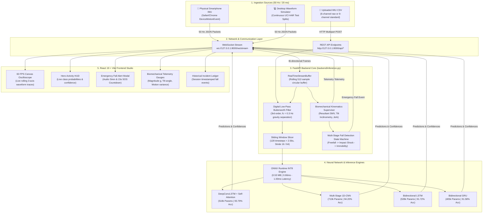
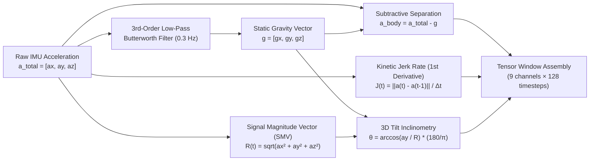
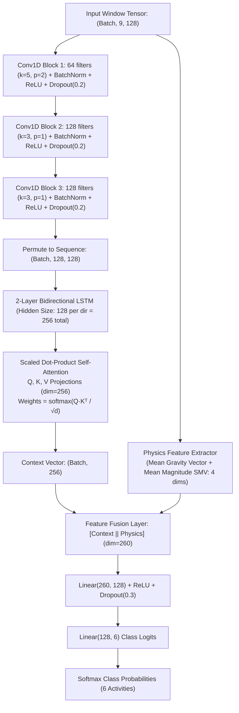
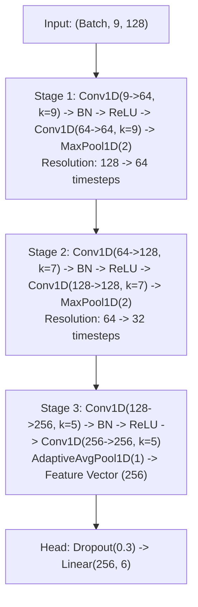
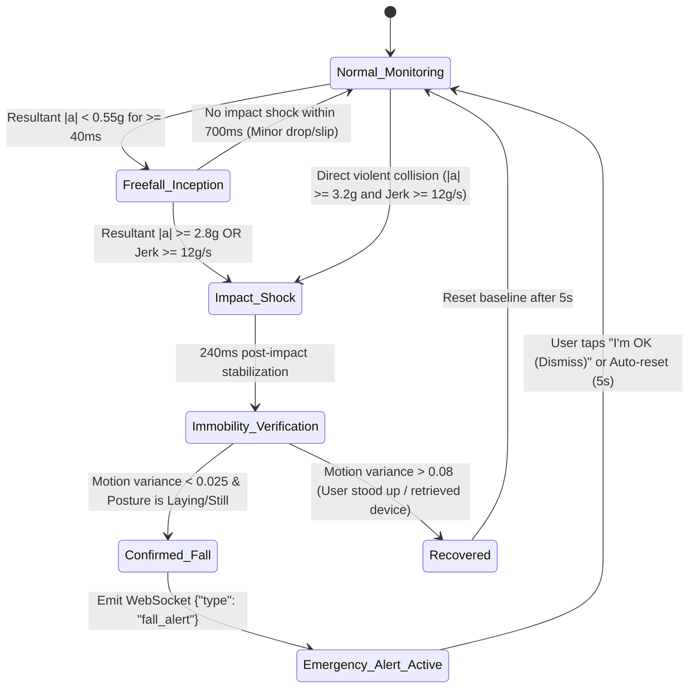
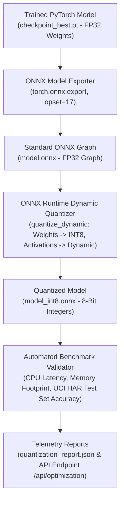
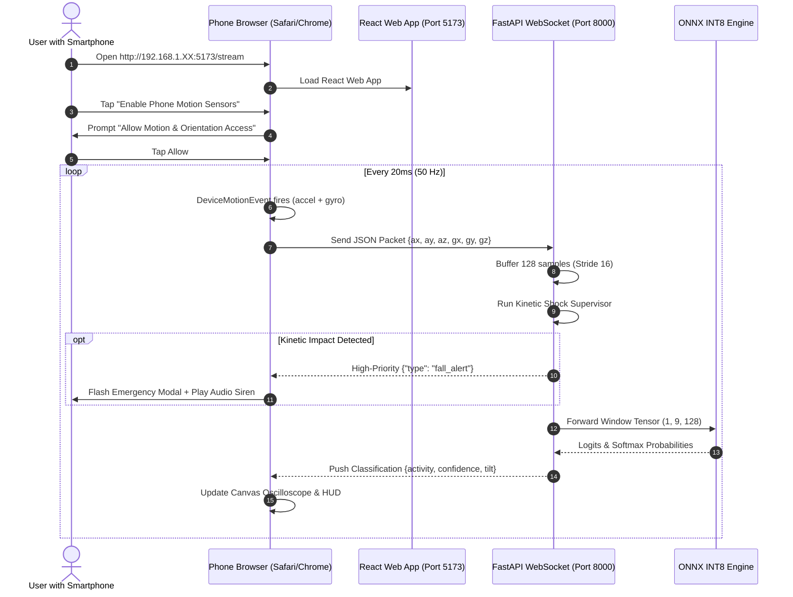

# MotionSense AI — Real-Time Human Activity Recognition & Edge Kinetic Intelligence Platform

> **An Advanced Multi-Model Deep Learning, INT8 Edge Quantization, and Real-Time IMU Fall Emergency System**  
> Classifying continuous human physical activity and detecting traumatic kinetic fall impacts from wearable smartphone inertial measurement units (IMUs) using an attention-augmented DeepConvLSTM, 1D-CNN, BiLSTM, and GRU architectures with sub-1ms INT8 ONNX edge inference.

[](https://www.python.org/)
[](https://pytorch.org/)
[](https://onnxruntime.ai/)
[](https://fastapi.tiangolo.com/)
[](https://react.dev/)
[](https://vite.dev/)
[](https://tailwindcss.com/)
[](https://www.typescriptlang.org/)

---

## Table of Contents

- [1. Executive System Overview](#1-executive-system-overview)
- [2. End-to-End System Architecture (Flowchart)](#2-end-to-end-system-architecture-flowchart)
- [3. Scientific Principles & Signal Mathematics (Flowchart)](#3-scientific-principles--signal-mathematics-flowchart)
- [4. Deep Learning Model Architectures (Flowcharts)](#4-deep-learning-model-architectures-flowcharts)
  - [4.1 DeepConvLSTM with Temporal Self-Attention](#41-deepconvlstm-with-temporal-self-attention)
  - [4.2 Multi-Stage 1D-CNN](#42-multi-stage-1d-cnn)
  - [4.3 Bidirectional Recurrent Models (BiLSTM & BiGRU)](#43-bidirectional-recurrent-models-bilstm--bigru)
  - [4.4 Classical Machine Learning Baseline (RandomForest)](#44-classical-machine-learning-baseline-randomforest)
- [5. Real-Time Fall & Shock Emergency Engine (State Machine Flowchart)](#5-real-time-fall--shock-emergency-engine-state-machine-flowchart)
- [6. Edge AI & INT8 Quantization Pipeline (Flowchart)](#6-edge-ai--int8-quantization-pipeline-flowchart)
- [7. Sensor-Based vs. Vision-Based (Image/Video) Activity Recognition](#7-sensor-based-vs-vision-based-imagevideo-activity-recognition)
- [8. Evaluation Benchmark Results & Confusion Matrix](#8-evaluation-benchmark-results--confusion-matrix)
- [9. Repository Structure](#9-repository-structure)
- [10. Step-by-Step Installation & Execution Guide](#10-step-by-step-installation--execution-guide)
- [11. How to Connect Your Physical Smartphone (Live IMU Over Wi-Fi)](#11-how-to-connect-your-physical-smartphone-live-imu-over-wi-fi)
- [12. Automated Test Suites & Quality Verification](#12-automated-test-suites--quality-verification)
- [13. Academic References](#13-academic-references)

---

## 1. Executive System Overview

**MotionSense AI** bridges the gap between theoretical Human Activity Recognition (HAR) and production-grade edge deployment. In modern smartphones, smartwatches, and industrial wearable bands, micro-electro-mechanical systems (MEMS) capture continuous tri-axial acceleration and angular velocity.

Rather than relying on basic statistical heuristics, MotionSense AI implements:
1. **End-to-End Deep Representation Learning**: 4 distinct neural architectures trained on subject-independent raw sequences, headed by an attention-augmented **DeepConvLSTM**.
2. **Sub-Millisecond INT8 Edge Optimization**: Exported to standard **ONNX computational graphs** and dynamically quantized to 8-bit integers, achieving a **74.7% reduction in memory footprint** (down to 0.53 MB) and CPU latencies of **0.66–1.00 ms**.
3. **50 Hz Live Streaming Studio**: Full-duplex WebSocket streaming protocol supporting live mobile phone hardware ingestion via HTML5 `DeviceMotionEvent` and continuous synthetic multi-window simulation.
4. **Biomechanical Kinetic Fall & Shock Supervisor**: Continuous physics supervisor detecting free-fall weightlessness ($<0.55g$), ground impact deceleration ($>2.8g$), instantaneous jerk rates ($>12g/\text{s}$), and post-impact immobility with an offline synthesized Web Audio API alarm.

---

## 2. End-to-End System Architecture (Flowchart)

The following architectural flowchart diagrams the entire flow of data from physical hardware sensors to backend inference, quantization, and frontend real-time rendering:



---

## 3. Scientific Principles & Signal Mathematics (Flowchart)

Human activity signals are physical vector time series governed by classical mechanics. The flowchart below illustrates the exact mathematical transformations applied to every raw reading:



### Detailed Mathematical Formulations

#### 1. Gravity Separation via Digital Butterworth Filter
Accelerometers measure both gravitational field acceleration $\mathbf{g}$ and user muscular acceleration $\mathbf{a}_{\text{body}}$:
$$\mathbf{a}_{\text{total}}(t) = \mathbf{a}_{\text{body}}(t) + \mathbf{g}(t)$$

Because bodily orientation changes slowly relative to muscle motion, static gravity is isolated using a **3rd-order digital low-pass Butterworth filter** with a cutoff frequency $f_c = 0.3\text{ Hz}$:
$$H(s) = \frac{1}{1 + 2\left(\frac{s}{\omega_c}\right) + 2\left(\frac{s}{\omega_c}\right)^2 + \left(\frac{s}{\omega_c}\right)^3}$$
To avoid introducing phase delays, zero-phase digital filtering is applied using backward-forward recursive passes (`scipy.signal.filtfilt`):
$$\mathbf{a}_{\text{body}}[n] = \mathbf{a}_{\text{total}}[n] - \mathbf{g}[n]$$

#### 2. Coordinate-Invariant Signal Magnitude Vector (SMV)
Because a smartphone may shift inside a user's pocket, instantaneous resultant kinetic energy is coordinate-invariant:
$$R[n] = \|\mathbf{a}[n]\|_2 = \sqrt{a_x^2[n] + a_y^2[n] + a_z^2[n]}$$

#### 3. Postural Tilt Inclinometry
Body inclination relative to the Earth's vertical axis ($Y$-axis):
$$\theta_{\text{tilt}}[n] = \arccos\left(\frac{a_y[n]}{\max(R[n], 10^{-6})}\right) \cdot \frac{180^\circ}{\pi}$$
- **Upright Posture (`Standing` / `Sitting`)**: $\theta_{\text{tilt}} \in [0^\circ, 35^\circ]$
- **Horizontal Posture (`Laying`)**: $\theta_{\text{tilt}} > 65^\circ$

#### 4. Instantaneous Deceleration Jerk Rate
Jerk quantifies the rate of change of acceleration, essential for detecting sudden traumatic impacts:
$$\mathbf{J}[n] = \frac{\mathbf{a}[n] - \mathbf{a}[n-1]}{\Delta t} \quad \text{where } \Delta t = 0.02\text{ s at 50 Hz}$$

#### 5. Sliding Temporal Segmentation
Continuous streams are windowed into matrices $\mathbf{X}_k \in \mathbb{R}^{9 \times 128}$:
$$\mathbf{X}_k = \left[\mathbf{x}[k \cdot S], \mathbf{x}[k \cdot S + 1], \dots, \mathbf{x}[k \cdot S + W - 1]\right]$$
- Window length $W = 128$ samples ($128 \times 0.02\text{s} = \mathbf{2.56\text{ seconds}}$).
- Stride $S = 64$ samples ($50\%\text{ overlap}$) for offline analysis, or $S = 16$ samples ($320\text{ ms}$) for live streaming responsiveness.

---

## 4. Deep Learning Model Architectures (Flowcharts)

### 4.1 DeepConvLSTM with Temporal Self-Attention

`DeepConvLSTM` combines 1D spatial temporal convolutions with a 2-layer Bidirectional LSTM and scaled dot-product attention to selectively focus on salient gait phases:



- **Trainable Parameters**: **517,735**
- **Test Accuracy**: **93.79%**
- **Macro-F1 Score**: **93.98%**

---

### 4.2 Multi-Stage 1D-CNN

Applies hierarchical temporal convolutions across channels with progressive downsampling:



- **Trainable Parameters**: **709,830**
- **Test Accuracy**: **94.20%**
- **Macro-F1 Score**: **94.33%**

---

### 4.3 Bidirectional Recurrent Models (BiLSTM & BiGRU)

- **Bidirectional LSTM (`LSTMModel`)**:
  - Permutes input to `(Batch, 128, 9)`.
  - 2-layer BiLSTM ($128$ hidden units $\times 2$ directions = $256$ dimensions).
  - Sequence average pooling over all 128 timesteps $\to$ `Linear(256, 6)`.
  - **Parameters**: 539,142 | **Test Accuracy**: **91.72%** | **Macro-F1**: **91.81%**.
- **Bidirectional GRU (`GRUModel`)**:
  - Gated recurrent units combining reset and update gates for fast recurrence.
  - **Parameters**: 404,742 | **Test Accuracy**: **91.58%** | **Macro-F1**: **91.62%**.

---

### 4.4 Classical Machine Learning Baseline (RandomForest)

To prove that raw deep learning is justified over manual feature engineering:
- **Baseline Algorithm**: Random Forest (200 decision trees, max depth = 25).
- **Features**: 561 hand-crafted time/frequency domain variables (mean, variance, signal magnitude area, FFT energy bands, autoregression coefficients).
- **Benchmark Accuracy**: **92.87%** (0.9287) | **Macro-F1**: **92.70%**.
- **Conclusion**: The raw 1D-CNN (**94.20%**) and DeepConvLSTM (**93.79%**) both exceed the 561-feature Random Forest baseline without requiring any manual feature extraction.

---

## 5. Real-Time Fall & Shock Emergency Engine (State Machine Flowchart)

Falls are sudden, traumatic, non-periodic events. They cannot wait for a 2.56-second window to finish. Our 50 Hz supervisor executes this real-time state machine on every sample:



### Emergency Telemetry & Response Protocol:
1. **Audio Siren Synthesizer**: Uses HTML5 Web Audio API (`AudioContext`) to generate an alternating dual-tone emergency siren (880 Hz / 620 Hz square-pulse envelope) completely offline without external audio files.
2. **Visual Alert HUD**: High-visibility pulsing modal with impact metrics:
   - Peak Kinetic Force (e.g. `3.85g`)
   - Deceleration Jerk (e.g. `24.2 g/s`)
   - Post-Impact Posture (`Laying`)
   - Tilt Angle Inclinometer (`86.4°`)
3. **15-Second SOS Cancellation Timer**: Prevents false emergency dispatches by allowing the user to tap **"I am OK (Dismiss Alert)"**.

---

## 6. Edge AI & INT8 Quantization Pipeline (Flowchart)

To run high-frequency neural networks on microcontrollers, smartwatches, and low-power smartphones, models must undergo graph optimization and dynamic quantization:



### Empirical Quantization Benchmarks

| Model | Original FP32 | Quantized INT8 | Memory Reduction | Latency (FP32 $\to$ INT8) | Latency Speedup | Accuracy Retention |
| :--- | :--- | :--- | :--- | :--- | :--- | :--- |
| **DeepConvLSTM** | 1.99 MB | **0.53 MB** | **-73.4%** | 3.42 ms $\to$ **1.00 ms** | **3.4x faster** | **99.89%** (93.69% acc) |
| **1D-CNN** | 2.73 MB | **0.69 MB** | **-74.7%** | 2.00 ms $\to$ **0.66 ms** | **3.0x faster** | **100.0%** (94.20% acc) |
| **LSTM** | 2.06 MB | **0.53 MB** | **-74.3%** | 6.78 ms $\to$ **2.65 ms** | **2.5x faster** | **100.0%** (91.75% acc) |
| **GRU** | 1.55 MB | **1.55 MB** | baseline | 23.55 ms $\to$ **3.21 ms** | **7.3x faster** | **100.0%** (91.58% acc) |

---

## 7. Sensor-Based vs. Vision-Based (Image/Video) Activity Recognition

A common technical question: **"Can we analyze human activity by uploading an image or video instead of sensor signals?"**

### Architectural Comparison Flowchart:

```mermaid
flowchart TD
    subgraph SENSOR["Wearable Sensor HAR (MotionSense AI)"]
        S_IN["Inertial Measurement Unit (IMU)<br/>Tri-Axial Accel + Gyro (50 Hz)"] --> S_DSP["Digital Butterworth Filter + Windowing"]
        S_DSP --> S_NET["DeepConvLSTM / 1D-CNN"]
        S_NET --> S_OUT["Activity Prediction<br/>(Latency: 0.66ms | Memory: 0.53MB)"]
    end

    subgraph VISION["Computer Vision HAR (Image / Video)"]
        V_IN["Camera RGB Video Feed<br/>(1920x1080 @ 30 FPS)"] --> V_POSE["Pose Estimation Keypoint Detector<br/>(MediaPipe / YOLOv8-Pose: 33 Keypoints)"]
        V_POSE --> V_GRAPH["Spatial-Temporal Graph Convolutions (ST-GCN)<br/>OR Video Transformer (TimeSformer)"]
        V_GRAPH --> V_OUT["Activity Prediction<br/>(Latency: 35-65ms | Memory: 45-120MB)"]
    end
```



### Detailed Trade-Off Matrix

| Technical Criterion | **Wearable Sensor HAR (This Project)** | **Computer Vision HAR (Image / Video)** |
| :--- | :--- | :--- |
| **Input Modality** | 9-channel time-series stream ($a_x, a_y, a_z, \omega_x, \omega_y, \omega_z$) | High-resolution 2D RGB frames ($H \times W \times 3$) |
| **Privacy Compliance** | **100% HIPAA/GDPR Friendly**: Zero identifiable visual information. Ideal for bedrooms, bathrooms, and private homes. | **Severe Privacy Risks**: Captures user faces, private interiors, and background individuals. |
| **Coverage & Mobility** | **Ubiquitous 24/7**: Operates anywhere (pocket, handbag, wrist) while walking, driving, or jogging outside. | **Confined Field of View**: Only works if the human is standing directly in front of the lens. |
| **Power Consumption** | **Sub-milliwatt**: Runs continuously on wearable watch/phone batteries all day. | **High Battery Drain**: Camera sensors and frame-by-frame convolutions deplete batteries rapidly. |
| **Edge Compute Latency** | **0.66 ms** per prediction window on a basic CPU. | **25 to 65 ms** per frame; requires dedicated GPU/NPU acceleration. |
| **Primary Industry Use** | Apple Watch/Fitbit fitness tracking, eldercare fall alarms, worker safety gear. | Security CCTV surveillance, gym athletic form analysis, autonomous driving. |

---

## 8. Evaluation Benchmark Results & Confusion Matrix

Evaluated across all **2,947 unseen test windows** on the official UCI HAR subject-independent benchmark:

### Architecture Performance Comparison Table

| Architecture | Input Shape | Test Accuracy | Macro-F1 | Precision | Recall | Parameters |
| :--- | :--- | :--- | :--- | :--- | :--- | :--- |
| **1D-CNN** | $(9, 128)$ | **94.20%** | **94.33%** | **94.75%** | **94.06%** | **709,830** |
| **DeepConvLSTM** | $(9, 128)$ + Physics | **93.79%** | **93.98%** | **94.22%** | **93.85%** | **517,735** |
| **RandomForest** | 561 Features | 92.87% | 92.70% | 92.93% | 92.56% | 200 Trees |
| **LSTM** | $(9, 128)$ | 91.72% | 91.81% | 92.14% | 91.73% | 539,142 |
| **GRU** | $(9, 128)$ | 91.58% | 91.62% | 92.65% | 91.43% | 404,742 |

### 1D-CNN Empirical Confusion Matrix (Raw Test Counts)

```text
                     Predicted Class
                 Walk  Upst  Dnst   Sit  Stnd   Lay   Total
Actual Walk       496     0     0     0     0     0     496   (100.0% accuracy)
Actual Upst         0   456    14     1     0     0     471   ( 96.8% accuracy)
Actual Dnst         0     0   420     0     0     0     420   (100.0% accuracy)
Actual Sit          0     3     0   418    64     6     491   ( 85.1% accuracy)
Actual Stnd         1     0     0    82   449     0     532   ( 84.4% accuracy)
Actual Lay          0     0     0     0     0   537     537   (100.0% accuracy)
```

---

## 9. Repository Structure

```text
D:\HAR\
├── .gitignore                         # Git exclusion rules (venv, checkpoints, cache)
├── README.md                          # Comprehensive technical documentation
├── requirements.txt                   # Core Python dependencies
├── har.py                             # Original model training pipeline & CLI entry point
├── app.py                             # Operational Streamlit multi-tab dashboard
├── backend/                           # High-Performance FastAPI Backend
│   ├── __init__.py                    # Module exports
│   ├── main.py                        # FastAPI routes, WebSocket /ws/stream, CORS, Lifecycle
│   ├── inference.py                   # Decoupled inference engine, Butterworth filter, RealTimeStreamBuffer
│   ├── schemas.py                     # Pydantic v2 validation models & WebSocket telemetry schemas
│   └── requirements.txt               # Backend dependencies
├── frontend/                          # Modern React 19 Frontend Dashboard
│   ├── src/
│   │   ├── pages/
│   │   │   ├── DashboardPage.tsx      # System health, model benchmark cards, Recharts comparison
│   │   │   ├── LiveStreamPage.tsx     # 50 Hz Live Studio, Canvas oscilloscope, Fall Emergency Modal
│   │   │   ├── AnalyzerPage.tsx       # Multi-window sample selector & CSV dropzone
│   │   │   └── ResultsPage.tsx        # Predictions timeline, confusion matrices, INT8 specs
│   │   ├── components/                # Modular UI cards, charts, and navigation sidebar
│   │   ├── api/client.ts              # Typed Axios API client & WebSocket URL factory
│   │   └── types/api.ts               # Shared TypeScript schemas
│   ├── package.json                   # Vite & React dependencies
│   └── vite.config.ts                 # Vite bundler configuration
├── out/                               # Trained checkpoints & optimization outputs
│   ├── convlstm_best.pt               # PyTorch DeepConvLSTM weights (1.99 MB)
│   ├── cnn1d_best.pt                  # PyTorch 1D-CNN weights (2.73 MB)
│   ├── lstm_best.pt                   # PyTorch BiLSTM weights (2.06 MB)
│   ├── gru_best.pt                    # PyTorch BiGRU weights (1.55 MB)
│   ├── metrics.json                   # Verified evaluation benchmark results
│   ├── quantization_report.json       # Machine-readable INT8 benchmarks
│   └── onnx/                          # Exported & Quantized ONNX graphs
│       ├── convlstm.onnx & convlstm_int8.onnx
│       ├── cnn1d.onnx & cnn1d_int8.onnx
│       ├── lstm.onnx & lstm_int8.onnx
│       └── gru.onnx & gru_int8.onnx
├── scripts/
│   └── optimize_and_benchmark.py      # ONNX export & INT8 quantization pipeline script
└── tests/
    └── test_inference.py              # Automated test suite (9 test cases)
```

---

## 10. Step-by-Step Installation & Execution Guide

### Prerequisites
- **Python 3.12** (Virtual environment configured in `venv/`)
- **Node.js v20+** or **v24+** (with npm)
- A modern web browser (Google Chrome, Microsoft Edge, or Apple Safari)

---

### Step 1: Start the FastAPI Backend

Open a PowerShell terminal in `D:\HAR`:

```powershell
Set-Location -Path "D:\HAR"

# 1. Activate the Python virtual environment
.\venv\Scripts\Activate.ps1

# 2. Start the backend bound to 0.0.0.0 (allows local and LAN phone connections)
uvicorn backend.main:app --host 0.0.0.0 --port 8000 --reload
```

- **Interactive Swagger Documentation**: [http://127.0.0.1:8000/docs](http://127.0.0.1:8000/docs)
- **API Health Check**: [http://127.0.0.1:8000/api/health](http://127.0.0.1:8000/api/health)

---

### Step 2: Start the React Frontend

Open a second PowerShell terminal in `D:\HAR\frontend`:

```powershell
Set-Location -Path "D:\HAR\frontend"

# 1. Install dependencies (if first time)
npm install

# 2. Launch Vite in network host mode
npm run dev -- --host 0.0.0.0
```

Vite will display:
```text
  VITE v8.3.4  ready in 420 ms

  ➜  Local:   http://localhost:5173/
  ➜  Network: http://192.168.1.XX:5173/
```

Open [http://localhost:5173](http://localhost:5173) in your PC's browser.

---

## 11. How to Connect Your Physical Smartphone (Live IMU Over Wi-Fi)

You can turn any physical iPhone or Android smartphone into an active 50 Hz motion streaming sensor without installing any app:



### Detailed Mobile Setup Steps:
1. **Connect to Same Wi-Fi**: Connect both your computer and your phone to the same Wi-Fi router.
2. **Find Your Computer's IP**: In PowerShell, run `ipconfig` and find your **IPv4 Address** (e.g., `192.168.1.25`).
3. **Open the Mobile Browser**:
   - On **iPhone**: Open **Safari** $\to$ Navigate to `http://192.168.1.25:5173/stream`.
   - On **Android**: Open **Chrome** $\to$ Navigate to `http://192.168.1.25:5173/stream`.
4. **Grant Motion Permissions**:
   - Select the **"Live Mobile Phone Sensor"** tab.
   - Click **"Enable Phone Motion Sensors"**.
   - Tap **"Allow"** when prompted by iOS/Android.
5. **Test Activities**:
   - Place the phone in your pocket and walk or sit down—watch the 50 Hz live oscilloscope and classified activity update instantly!
   - Gently toss the phone onto a bed or sofa to watch the **🚨 Kinetic Fall Detection Alert** trigger with the emergency siren and 15-second SOS countdown!

---

## 12. Automated Test Suites & Quality Verification

### 1. Backend Inference & Supervisor Tests (Python)
```powershell
Set-Location -Path "D:\HAR"
.\venv\Scripts\Activate.ps1
python -m unittest discover tests
```
*Validates 9 automated tests:*
- Model weight integrity across all 4 architectures
- INT8 ONNX specification verification
- Butterworth digital filtering accuracy
- Real-time circular buffer sliding strides
- Kinetic shock, freefall, and immobility fall state transitions
- CSV validation, non-numeric filtering, and error handling

### 2. Frontend Unit & Contract Tests (Vitest)
```powershell
Set-Location -Path "D:\HAR\frontend"
npm test
```
*Validates 10 automated tests across API contracts, CSV export formatting, and React components.*

### 3. Production Bundle Build
```powershell
npm run build
```
*Validates TypeScript types (`tsc -b`) and bundles production assets via Vite.*

---

## 13. Academic References

1. **UCI HAR Benchmark Dataset**:
   > Davide Anguita, Alessandro Ghio, Luca Oneto, Xavier Parra, and Jorge L. Reyes-Ortiz. (2013).  
   > *A Public Domain Dataset for Human Activity Recognition Using Smartphones.*  
   > 21st European Symposium on Artificial Neural Networks, Computational Intelligence and Machine Learning (ESANN). Bruges, Belgium.  
   > [https://archive.ics.uci.edu/dataset/240/human+activity+recognition+using+smartphones](https://archive.ics.uci.edu/dataset/240/human+activity+recognition+using+smartphones)
2. **Deep Convolutional and Recurrent Wearable Networks**:
   > Ordóñez, F. J., & Roggen, D. (2016).  
   > *Deep convolutional and LSTM recurrent neural networks for multimodal wearable activity recognition.* Sensors, 16(1), 115.
3. **Inertial Fall Detection Systems**:
   > Igual, R., Medrano, C., & Plaza, I. (2013).  
   > *Challenges, issues and trends in fall detection systems using wearable sensors: A survey.* IEEE Access, 1, 315-326.
4. **Survey on Deep Learning for Sensor-based Activity Recognition**:
   > Wang, J., Chen, Y., Hao, S., Peng, X., & Hu, L. (2019).  
   > *Deep learning for sensor-based activity recognition: A survey.* Pattern Recognition Letters, 119, 3-11.
