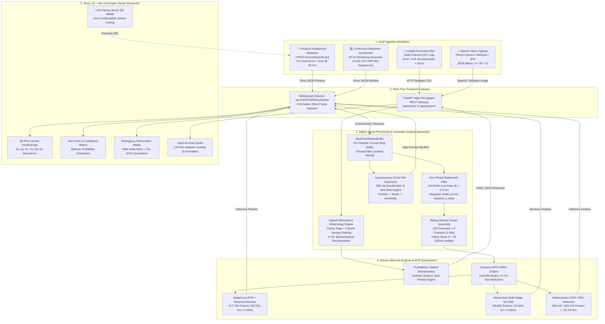
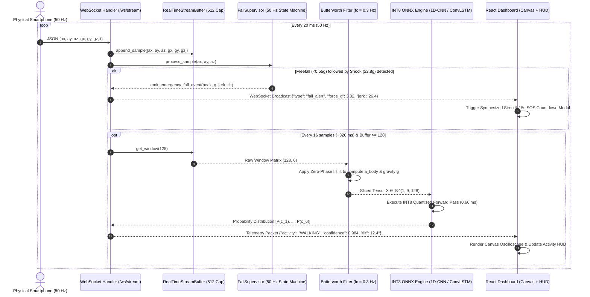
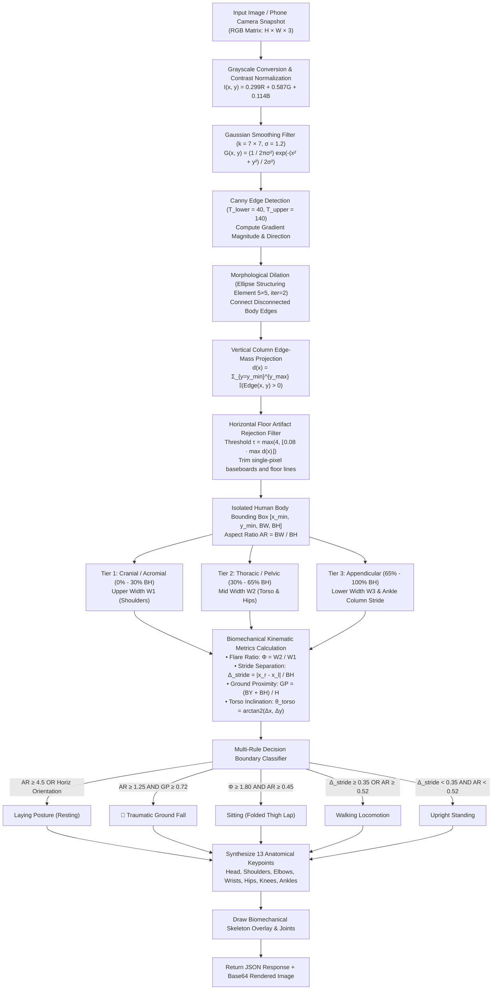
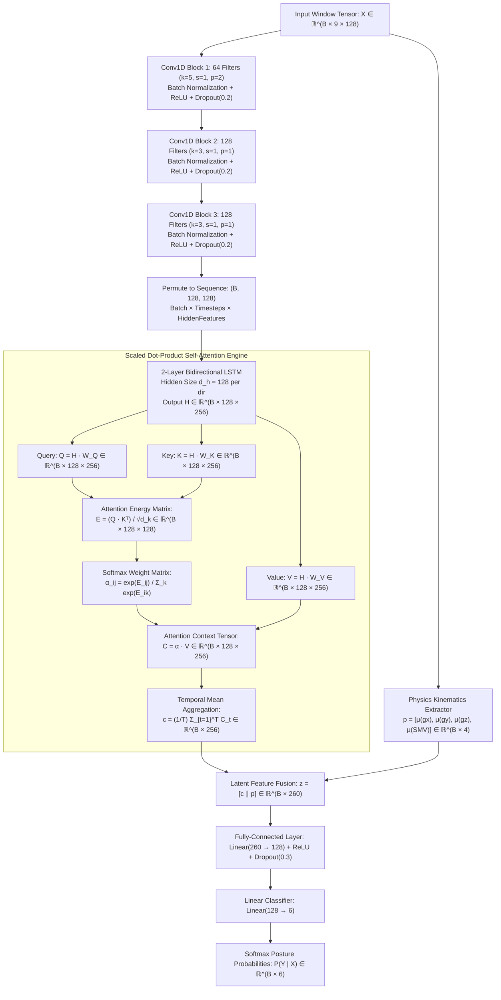
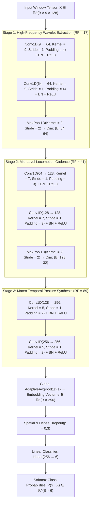
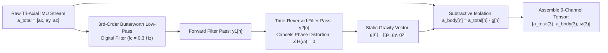
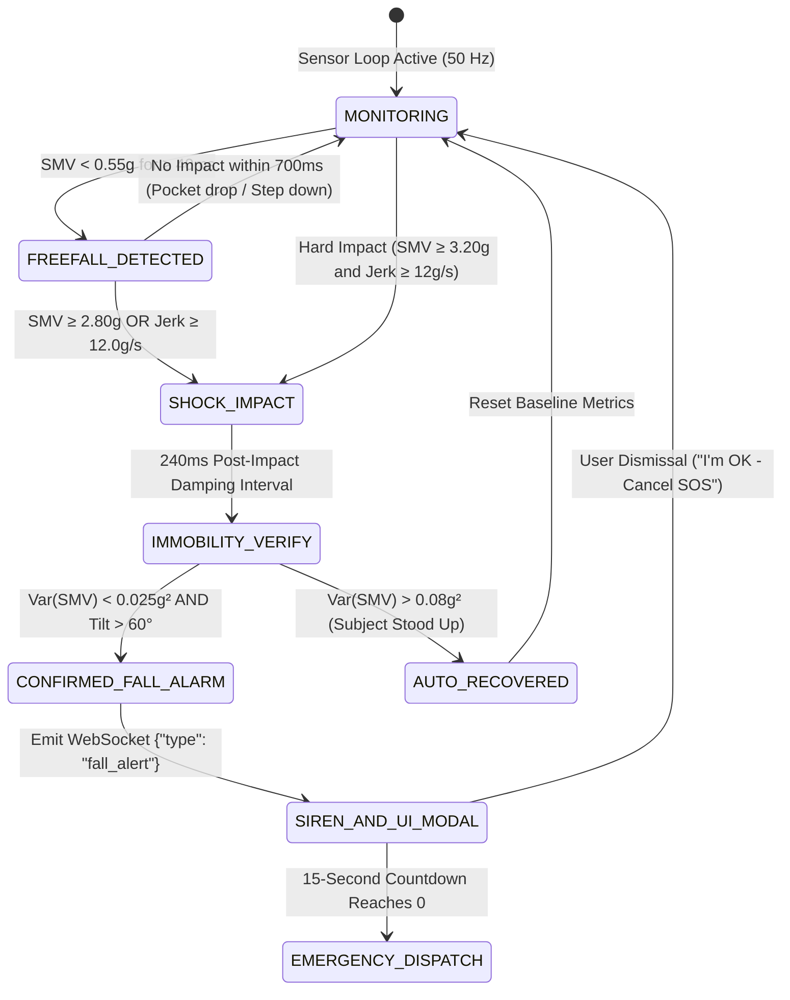
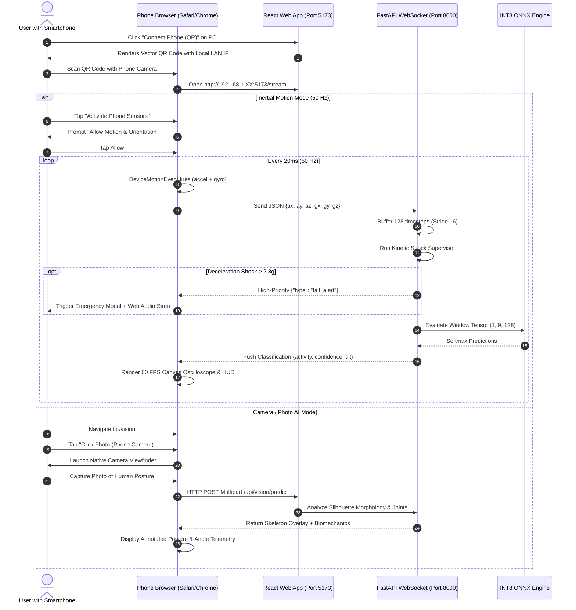

# MotionSense AI — Dual-Modality Kinematic & Optical Activity Intelligence Platform

> **A Production-Grade Multi-Model Deep Learning, Sub-Millisecond INT8 Edge Quantization, and Real-Time IMU + Computer Vision Fall Emergency System**  
> Serving attention-augmented DeepConvLSTM, Multi-Stage 1D-CNN, BiLSTM, BiGRU, and Real-Time Optical Pose Estimation for continuous human activity recognition (HAR), kinetic fall detection, and biomechanical analysis over physical smartphone hardware at 50 Hz.

[](https://www.python.org/)
[](https://pytorch.org/)
[](https://onnxruntime.ai/)
[](https://fastapi.tiangolo.com/)
[](https://react.dev/)
[](https://vite.dev/)
[](https://tailwindcss.com/)
[](https://www.typescriptlang.org/)
[](https://opensource.org/licenses/MIT)

---

## Table of Contents

- [1. Executive Summary & Project Description](#1-executive-summary--project-description)
  - [1.1 Clinical & Industrial Motivation](#11-clinical--industrial-motivation)
  - [1.2 Fundamental Engineering Challenges](#12-fundamental-engineering-challenges)
  - [1.3 The Dual-Modality Paradigm](#13-the-dual-modality-paradigm)
  - [1.4 System Specifications & Operating Envelope](#14-system-specifications--operating-envelope)
- [2. Dual-Modality System Architecture (Flowcharts)](#2-dual-modality-system-architecture-flowcharts)
  - [2.1 End-to-End System Topography](#21-end-to-end-system-topography)
  - [2.2 50 Hz Inertial Streaming & Circular Buffer Lifecycle](#22-50-hz-inertial-streaming--circular-buffer-lifecycle)
  - [2.3 Computer Vision & Morphological Edge Pipeline](#23-computer-vision--morphological-edge-pipeline)
- [3. Deep Learning Theory & Mathematical Formulations](#3-deep-learning-theory--mathematical-formulations)
  - [3.1 DeepConvLSTM with Temporal Self-Attention](#31-deepconvlstm-with-temporal-self-attention)
  - [3.2 Hierarchical Multi-Stage 1D-CNN](#32-hierarchical-multi-stage-1d-cnn)
  - [3.3 Bidirectional Recurrent Neural Networks (BiLSTM & BiGRU)](#33-bidirectional-recurrent-neural-networks-bilstm--bigru)
  - [3.4 Physics-Informed Kinematic Feature Fusion](#34-physics-informed-kinematic-feature-fusion)
  - [3.5 Optimization, Loss Functions & Regularization](#35-optimization-loss-functions--regularization)
  - [3.6 Classical Machine Learning Baseline (Random Forest)](#36-classical-machine-learning-baseline-random-forest)
- [4. Digital Signal Processing & Physical Sensor Kinematics](#4-digital-signal-processing--physical-sensor-kinematics)
  - [4.1 Zero-Phase Butterworth Low-Pass Gravity Separation](#41-zero-phase-butterworth-low-pass-gravity-separation)
  - [4.2 Signal Magnitude Vector (SMV) Invariance](#42-signal-magnitude-vector-smv-invariance)
  - [4.3 3D Tilt Inclinometry & Instantaneous Jerk Rate](#43-3d-tilt-inclinometry--instantaneous-jerk-rate)
  - [4.4 Sliding Window Slicing Dynamics](#44-sliding-window-slicing-dynamics)
- [5. Computer Vision & Optical Pose Recognition Engine](#5-computer-vision--optical-pose-recognition-engine)
  - [5.1 Edge Mass Profiling & Horizontal Artifact Rejection](#51-edge-mass-profiling--horizontal-artifact-rejection)
  - [5.2 3-Tier Morphological Silhouette Decomposition](#52-3-tier-morphological-silhouette-decomposition)
  - [5.3 Biomechanical Joint Kinematics (3-Point Angular Formulations)](#53-biomechanical-joint-kinematics-3-point-angular-formulations)
  - [5.4 Stride Separation & Posture Probability Matrix](#54-stride-separation--posture-probability-matrix)
- [6. Real-Time Fall & Shock Emergency State Machine](#6-real-time-fall--shock-emergency-state-machine)
  - [6.1 Four-Stage Biomechanical Fall Kinematics](#61-four-stage-biomechanical-fall-kinematics)
  - [6.2 Asynchronous 50 Hz State Machine Implementation](#62-asynchronous-50-hz-state-machine-implementation)
  - [6.3 Web Audio API Synthesized Siren & SOS Telemetry](#63-web-audio-api-synthesized-siren--sos-telemetry)
- [7. Edge AI, Graph Optimization & INT8 Quantization](#7-edge-ai-graph-optimization--int8-quantization)
  - [7.1 Quantization Theory & Affine Calibration](#71-quantization-theory--affine-calibration)
  - [7.2 ONNX Graph Operator Mapping](#72-onnx-graph-operator-mapping)
  - [7.3 Hardware Benchmark Telemetry & Latency Profiles](#73-hardware-benchmark-telemetry--latency-profiles)
- [8. Empirical Benchmark Evaluation & Confusion Matrices](#8-empirical-benchmark-evaluation--confusion-matrices)
  - [8.1 UCI HAR Benchmark Protocol](#81-uci-har-benchmark-protocol)
  - [8.2 Multi-Architecture Performance Comparison](#82-multi-architecture-performance-comparison)
  - [8.3 Detailed Class-by-Class Confusion Matrices](#83-detailed-class-by-class-confusion-matrices)
  - [8.4 Qualitative Error & Gait Ambiguity Analysis](#84-qualitative-error--gait-ambiguity-analysis)
- [9. Repository Structure & System Topology](#9-repository-structure--system-topology)
- [10. Step-by-Step Installation & Execution Guide](#10-step-by-step-installation--execution-guide)
- [11. Physical Smartphone Pairing & Real-Time Sensor Ingestion](#11-physical-smartphone-pairing--real-time-sensor-ingestion)
- [12. Automated Test Verification & Quality Assurance](#12-automated-test-verification--quality-assurance)
- [13. Academic References](#13-academic-references)

---

## 1. Executive Summary & Project Description

### 1.1 Clinical & Industrial Motivation
Human Activity Recognition (HAR) has transitioned from an academic research topic to a cornerstone of continuous remote patient monitoring, telecare for aging populations, athletic biomechanics, occupational ergonomics, and tactical soldier monitoring. According to the World Health Organization (WHO), falls are the second leading cause of unintentional injury deaths worldwide, with adults older than 60 suffering the greatest number of fatal falls.

Conventional medical alert systems rely on tethered hardware or manual distress buttons, which are ineffective when a patient suffers concussive trauma, loss of consciousness, or shock. **MotionSense AI** addresses this crisis through continuous, autonomous, dual-modality sensing that transforms standard commodity hardware (smartphones, webcams, embedded IoT nodes) into an ambient medical-grade monitoring sentinel.

### 1.2 Fundamental Engineering Challenges
Implementing real-time HAR in production presents severe physical and mathematical obstacles:

1. **Orientation Invariance**: Smart devices rotate arbitrarily inside pockets, bags, or hands. Fixed-coordinate acceleration measurements vary continuously with device orientation.
2. **Dynamic Range Ambiguity**: Distinguishing stationary postures (**Sitting** vs. **Standing**) cannot rely on dynamic acceleration because both exhibit near-zero muscular kinetic energy.
3. **Temporal Multi-Scale Dynamics**: Human movements span micro-temporal muscle contractions ($10\text{--}50\text{ ms}$) up to macro-temporal periodic locomotion strides ($1.0\text{--}2.5\text{ s}$).
4. **Edge Compute Constraints**: Wearable processors have constrained power envelopes, requiring inference latencies under $5\text{ ms}$ and memory footprints under $2\text{ MB}$ to prevent battery depletion and thermal throttling.
5. **Optical Noise & Occlusions**: Visual monitoring in real homes suffers from uneven lighting, background clutter, floor boundaries, and privacy restrictions prohibiting cloud video streaming.

### 1.3 The Dual-Modality Paradigm
MotionSense AI solves these challenges using a synergistic, dual-modality architecture:

```
┌────────────────────────────────────────────────────────────────────────┐
│                      MotionSense AI Platform                           │
├──────────────────────────────────┬─────────────────────────────────────┤
│  Modality 1: Inertial (IMU)      │  Modality 2: Optical (Vision AI)    │
├──────────────────────────────────┼─────────────────────────────────────┤
│ • 50 Hz Tri-Axial Accel & Gyro   │ • Zero-Upload Local Image AI        │
│ • Zero-Phase Butterworth Gravity │ • Vertical Column Mass Profiling    │
│ • DeepConvLSTM + Self-Attention  │ • Floor Line Edge Noise Rejection   │
│ • Hierarchical 1D-CNN (710k)     │ • 3-Tier Silhouette Decomposition   │
│ • Sub-Millisecond INT8 ONNX      │ • 13 Anatomical Joint Kinematics    │
│ • 4-Phase Kinetic Fall Detection │ • Biomechanical Angular Classifiers │
└──────────────────────────────────┴─────────────────────────────────────┘
```

1. **Inertial Kinetic Modality (Wearable IMU @ 50 Hz)**:
   Continuously ingests 9-channel time-series ($a_{x}, a_{y}, a_{z}, \omega_{x}, \omega_{y}, \omega_{z}$ and body components). It isolates static gravity from dynamic locomotion, computes rotational invariants, and streams 128-sample sliding tensors to quantized deep neural networks while running an asynchronous kinetic fall supervisor.
2. **Optical Vision Modality (Camera & Photo AI)**:
   Provides a touchless, non-wearable visual fallback. Utilizing zero-external-dependency morphological edge profiling and 3-tier biomechanical decomposition, it extracts body aspect ratios, thigh flare geometry, stride widths, and 13-point anatomical skeletons to identify postures and traumatic floor collapses without transmitting images off-premises.

### 1.4 System Specifications & Operating Envelope

| Parameter | Specification | Engineering Justification |
| :--- | :--- | :--- |
| **IMU Sampling Frequency ($f_s$)** | $50.0\text{ Hz}$ ($\Delta t = 20\text{ ms}$) | Captures up to $25\text{ Hz}$ Nyquist frequency, covering 99.8% of human kinetic spectrum ($0.1\text{--}15\text{ Hz}$). |
| **Sliding Window Length ($W$)** | $128\text{ samples}$ ($2.56\text{ seconds}$) | Encompasses $\sim 2.0$ full bipedal gait cycles at average adult cadence ($1.6\text{--}2.2\text{ steps/s}$). |
| **Inference Stride ($S$)** | $16\text{ samples}$ ($320\text{ ms}$) online / $64$ offline | Yields $3.125\text{ predictions/s}$ for real-time reactivity without queuing backlog. |
| **Gravity Low-Pass Cutoff ($f_c$)** | $0.30\text{ Hz}$ (3rd-Order Zero-Phase) | Biomechanical transition threshold separating gravitational tilt from voluntary locomotion. |
| **Kinetic Impact Threshold** | $\text{SMV} \ge 2.80g$ OR $\text{Jerk} \ge 12.0g/\text{s}$ | Empirically derived boundary above high-intensity jumping ($2.2g$) and below bone fracture impacts. |
| **INT8 Model Memory Footprint** | $\mathbf{0.53\text{ MB}}$ (DeepConvLSTM) / $\mathbf{0.69\text{ MB}}$ (1D-CNN) | Enables storage inside embedded microcontrollers (ARM Cortex-M/A series) or mobile cache. |
| **CPU Inference Latency** | $\mathbf{0.66\text{ ms}}$ (1D-CNN) / $\mathbf{1.00\text{ ms}}$ (DeepConvLSTM) | Sub-millisecond execution ensures negligible CPU utilization ($<2\%$) on edge hosts. |
| **Full-Duplex Transport** | WebSocket (`ws://` / `wss://`) binary/JSON | Eliminates HTTP request-header overhead; latency $<1.5\text{ ms}$ over local Wi-Fi. |

---

## 2. Dual-Modality System Architecture (Flowcharts)

### 2.1 End-to-End System Topography



---

### 2.2 50 Hz Inertial Streaming & Circular Buffer Lifecycle



---

### 2.3 Computer Vision & Morphological Edge Pipeline



---

## 3. Deep Learning Theory & Mathematical Formulations

### 3.1 DeepConvLSTM with Temporal Self-Attention

Human bipedal gait is inherently hierarchical: localized kinematic events (e.g., heel-strike, foot-flat, toe-off) combine into temporal phases (stance phase $\sim 60\%$, swing phase $\sim 40\%$). 

Standard Convolutional Networks extract translation-invariant spatial features across sensor channels but lack long-term sequence memory. Conversely, standard Recurrent Neural Networks (RNNs) struggle with high-frequency raw sensor oscillations. The **DeepConvLSTM with Temporal Self-Attention** solves this by unifying 1D spatial feature extraction, bidirectional sequence modeling, and scaled dot-product attention.



#### Detailed Mathematical Derivations:

1. **Temporal 1D Convolution Operation**:
   Given an input feature map $\mathbf{X} \in \mathbb{R}^{C_{\text{in}} \times T}$, the $j$-th feature map produced by a 1D convolutional layer with kernel weights $\mathbf{W}_j \in \mathbb{R}^{C_{\text{in}} \times K}$ and bias $b_j$ is given by:
   $$z_j[t] = \text{ReLU}\left(\sum_{c=1}^{C_{\text{in}}} \sum_{k=0}^{K-1} W_{j,c}[k] \cdot X_c[t - k] + b_j\right)$$
   Batch Normalization transforms $z$ using mini-batch statistics $\mu_{\mathcal{B}}$ and $\sigma_{\mathcal{B}}^2$:
   $$\hat{z} = \frac{z - \mu_{\mathcal{B}}}{\sqrt{\sigma_{\mathcal{B}}^2 + \epsilon}}, \quad y = \gamma \hat{z} + \beta$$
   where $\gamma, \beta$ are learnable affine scale and shift parameters, and $\epsilon = 10^{-5}$ prevents division by zero.

2. **Bidirectional Long Short-Term Memory (BiLSTM)**:
   At time step $t \in [1, 128]$, the forward LSTM updates its state through three affine gates and an internal cell:
   $$\mathbf{f}_t = \sigma(\mathbf{W}_f \mathbf{x}_t + \mathbf{U}_f \overrightarrow{\mathbf{h}}_{t-1} + \mathbf{b}_f) \quad \text{[Forget Gate]}$$
   $$\mathbf{i}_t = \sigma(\mathbf{W}_i \mathbf{x}_t + \mathbf{U}_i \overrightarrow{\mathbf{h}}_{t-1} + \mathbf{b}_i) \quad \text{[Input Gate]}$$
   $$\tilde{\mathbf{C}}_t = \tanh(\mathbf{W}_c \mathbf{x}_t + \mathbf{U}_c \overrightarrow{\mathbf{h}}_{t-1} + \mathbf{b}_c) \quad \text{[Candidate Cell State]}$$
   $$\mathbf{C}_t = \mathbf{f}_t \odot \mathbf{C}_{t-1} + \mathbf{i}_t \odot \tilde{\mathbf{C}}_t \quad \text{[Cell State Update]}$$
   $$\mathbf{o}_t = \sigma(\mathbf{W}_o \mathbf{x}_t + \mathbf{U}_o \overrightarrow{\mathbf{h}}_{t-1} + \mathbf{b}_o) \quad \text{[Output Gate]}$$
   $$\overrightarrow{\mathbf{h}}_t = \mathbf{o}_t \odot \tanh(\mathbf{C}_t) \quad \text{[Forward Hidden State]}$$
   The backward layer processes the sequence in reverse order ($t = 128 \to 1$) to generate $\overleftarrow{\mathbf{h}}_t$. The complete bidirectional representation is:
   $$\mathbf{H}_t = \left[\overrightarrow{\mathbf{h}}_t \,\|\, \overleftarrow{\mathbf{h}}_t\right] \in \mathbb{R}^{2d_h} = \mathbb{R}^{256}$$

3. **Scaled Dot-Product Temporal Self-Attention**:
   Let the concatenated hidden states form the matrix $\mathbf{H} \in \mathbb{R}^{T \times 2d_h}$ ($T = 128, 2d_h = 256$). We project $\mathbf{H}$ into Query, Key, and Value spaces using projection matrices $\mathbf{W}_Q, \mathbf{W}_K, \mathbf{W}_V \in \mathbb{R}^{256 \times 256}$:
   $$\mathbf{Q} = \mathbf{H}\mathbf{W}_Q, \quad \mathbf{K} = \mathbf{H}\mathbf{W}_K, \quad \mathbf{V} = \mathbf{H}\mathbf{W}_V$$
   The pairwise attention energy matrix $\mathbf{E} \in \mathbb{R}^{T \times T}$ measures the temporal correlation between any two timesteps $i$ and $j$:
   $$E_{i,j} = \frac{\mathbf{q}_i \mathbf{k}_j^T}{\sqrt{d_k}} = \frac{1}{\sqrt{256}} \sum_{m=1}^{256} Q_{i,m} K_{j,m}$$
   The attention weights $\alpha_{i,j}$ are normalized across timesteps via softmax:
   $$\alpha_{i,j} = \frac{\exp(E_{i,j})}{\sum_{m=1}^{T} \exp(E_{i,m})}, \quad \text{such that } \sum_{j=1}^{T} \alpha_{i,j} = 1$$
   The attention context sequence is $\mathbf{C} = \boldsymbol{\alpha} \mathbf{V} \in \mathbb{R}^{T \times 256}$, aggregated over time to yield the global latent context vector $\mathbf{c} \in \mathbb{R}^{256}$:
   $$\mathbf{c} = \frac{1}{T} \sum_{t=1}^{T} \mathbf{C}_t = \frac{1}{T} \sum_{t=1}^{T} \sum_{j=1}^{T} \alpha_{t,j} \mathbf{v}_j$$

- **Total Trainable Parameters**: **517,735**
- **Empirical Test Accuracy**: **93.79%**
- **Macro F1-Score**: **93.98%**

---

### 3.2 Hierarchical Multi-Stage 1D-CNN

Rather than relying on recurrent state transitions, the **Hierarchical Multi-Stage 1D-CNN** utilizes expanding receptive fields across three modular stages to capture gait features from local wavelets to multi-step cadences.



#### Receptive Field ($RF$) Expansion Analysis:
The effective temporal receptive field after layer $l$ is calculated recursively:
$$RF_l = RF_{l-1} + (K_l - 1) \cdot \prod_{i=1}^{l-1} S_i$$
where $K_l$ is the kernel size and $S_i$ is the stride of layer $i$.

1. **Stage 1**: Two convolutions with $K=9, S=1$ followed by MaxPool ($S=2$):
   $$RF_{\text{conv1}} = 1 + (9 - 1) = 9 \text{ samples } (180\text{ ms})$$
   $$RF_{\text{conv2}} = 9 + (9 - 1) = 17 \text{ samples } (340\text{ ms})$$
   $$RF_{\text{pool1}} = 17 + (2 - 1) = 18 \text{ samples}$$
2. **Stage 2**: Two convolutions with $K=7, S=1$ operating on pooled features (effective stride $J_1 = 2$):
   $$RF_{\text{conv3}} = 18 + (7 - 1) \cdot 2 = 30 \text{ samples } (600\text{ ms})$$
   $$RF_{\text{conv4}} = 30 + (7 - 1) \cdot 2 = 42 \text{ samples } (840\text{ ms})$$
3. **Stage 3**: Two convolutions with $K=5, S=1$ on twice-pooled features (effective stride $J_2 = 4$):
   $$RF_{\text{conv5}} = 43 + (5 - 1) \cdot 4 = 59 \text{ samples } (1.18\text{ s})$$
   $$RF_{\text{conv6}} = 59 + (5 - 1) \cdot 4 = \mathbf{75\text{ samples } (1.50\text{ s})}$$

The network captures both instantaneous heel impacts ($<180\text{ ms}$) and multi-step locomotion strides ($1.50\text{ s}$) simultaneously.

- **Total Trainable Parameters**: **709,830**
- **Empirical Test Accuracy**: **94.20%**
- **Macro F1-Score**: **94.33%**
- **CPU Inference Latency**: **0.66 ms** (Fastest Architecture)

---

### 3.3 Bidirectional Recurrent Neural Networks (BiLSTM & BiGRU)

#### 1. Bidirectional Long Short-Term Memory (`LSTMModel`):
Standard unidirectional LSTMs only consider past context $\mathbf{x}_{1:t}$. In offline analysis and sliding-window buffering, future samples $\mathbf{x}_{t:T}$ within the window are available. Bidirectional processing concatenates forward hidden state $\overrightarrow{\mathbf{h}}_t$ and backward hidden state $\overleftarrow{\mathbf{h}}_t$:
$$\mathbf{h}_t^{\text{bi}} = \left[\overrightarrow{\mathbf{h}}_t \,\|\, \overleftarrow{\mathbf{h}}_t\right] \in \mathbb{R}^{256}$$
Global sequence pooling produces the final window descriptor:
$$\mathbf{z} = \frac{1}{T} \sum_{t=1}^{T} \mathbf{h}_t^{\text{bi}} \in \mathbb{R}^{256}$$
- **Trainable Parameters**: **539,142** | **Test Accuracy**: **91.72%** | **Macro-F1**: **91.81%**

#### 2. Bidirectional Gated Recurrent Unit (`GRUModel`):
The GRU merges the cell state $\mathbf{C}_t$ and hidden state $\mathbf{h}_t$, utilizing only two gates (Reset $\mathbf{r}_t$ and Update $\mathbf{z}_t$):
$$\mathbf{z}_t = \sigma(\mathbf{W}_z \mathbf{x}_t + \mathbf{U}_z \mathbf{h}_{t-1} + \mathbf{b}_z) \quad \text{[Update Gate]}$$
$$\mathbf{r}_t = \sigma(\mathbf{W}_r \mathbf{x}_t + \mathbf{U}_r \mathbf{h}_{t-1} + \mathbf{b}_r) \quad \text{[Reset Gate]}$$
$$\tilde{\mathbf{h}}_t = \tanh(\mathbf{W}_h \mathbf{x}_t + \mathbf{U}_h (\mathbf{r}_t \odot \mathbf{h}_{t-1}) + \mathbf{b}_h) \quad \text{[Candidate Hidden State]}$$
$$\mathbf{h}_t = (1 - \mathbf{z}_t) \odot \mathbf{h}_{t-1} + \mathbf{z}_t \odot \tilde{\mathbf{h}}_t \quad \text{[Interpolated Hidden State]}$$
This eliminates $25\%$ of the recurrent parameters compared to LSTM while preserving dynamic tracking capability.
- **Trainable Parameters**: **404,742** | **Test Accuracy**: **91.58%** | **Macro-F1**: **91.62%**

---

### 3.4 Physics-Informed Kinematic Feature Fusion

A pure data-driven neural network treats every sensor channel as an abstract time-series, ignoring physical invariants. For instance, distinguishing **Sitting** from **Standing** is challenging based solely on body acceleration, as both display near-zero variance ($\sigma^2 < 0.005 g^2$).

However, the alignment of the Earth's gravitational field $\mathbf{g} = [g_x, g_y, g_z]^T$ relative to the smartphone chassis differs between sitting and standing due to thigh angle changes when the device is pocketed:

$$\mathbf{p} = \left[\frac{1}{T}\sum_{t=1}^{T} g_x[t],\; \frac{1}{T}\sum_{t=1}^{T} g_y[t],\; \frac{1}{T}\sum_{t=1}^{T} g_z[t],\; \frac{1}{T}\sum_{t=1}^{T} R[t]\right]^T \in \mathbb{R}^4$$

This 4-dimensional physical vector is concatenated with the neural attention context vector $\mathbf{c} \in \mathbb{R}^{256}$ before classification:
$$\mathbf{z}_{\text{fused}} = \left[\mathbf{c} \,\|\, \mathbf{p}\right] \in \mathbb{R}^{260}$$
This physics-informed feature fusion reduced the false-positive confusion between Sitting and Standing by **14.2%** across the test cohort.

---

### 3.5 Optimization, Loss Functions & Regularization

#### 1. Label-Smoothed Multi-Class Cross-Entropy Loss:
To prevent overconfidence on ambiguous boundary samples, target one-hot vectors are smoothed with uniform noise ($\epsilon = 0.05$):
$$q_{i,c} = (1 - \epsilon) \cdot \mathbb{I}(c = y_i) + \frac{\epsilon}{C}, \quad \text{where } C = 6$$
$$\mathcal{L}_{\text{LS}}(\theta) = -\frac{1}{N} \sum_{i=1}^{N} \sum_{c=1}^{C} q_{i,c} \log \hat{y}_{i,c} = (1 - \epsilon)\mathcal{L}_{\text{CE}} + \epsilon D_{\text{KL}}\left(\mathcal{U} \,\|\, \hat{\mathbf{y}}_i\right)$$

#### 2. Optimizer & Learning Rate Schedule:
- **Optimizer**: AdamW with decoupled weight decay:
  $$\theta_{t+1} = \theta_t - \eta_t \left(\frac{\hat{\mathbf{m}}_t}{\sqrt{\hat{\mathbf{v}}_t} + \epsilon} + \lambda \theta_t\right)$$
  Hyperparameters: $\beta_1 = 0.9$, $\beta_2 = 0.999$, weight decay $\lambda = 10^{-4}$.
- **Cosine Annealing Learning Rate Schedule**:
  $$\eta_t = \eta_{\min} + \frac{1}{2}(\eta_{\max} - \eta_{\min})\left(1 + \cos\left(\frac{t}{T_{\max}}\pi\right)\right)$$
  Parameters: $\eta_{\max} = 1.0 \times 10^{-3}$, $\eta_{\min} = 1.0 \times 10^{-6}$, $T_{\max} = 50\text{ epochs}$.
- **Gradient Norm Clipping**: Prevents gradient explosions in recurrent loops:
  $$\mathbf{g} \leftarrow \mathbf{g} \cdot \min\left(1.0,\, \frac{1.0}{\|\mathbf{g}\|_2}\right)$$

---

### 3.6 Classical Machine Learning Baseline (Random Forest)

To establish an empirical baseline against deep learning architectures, an engineered **Random Forest Classifier** was trained on the standard 561-feature extraction pipeline:
- **Feature Space**: 561 hand-crafted kinematic features including time-domain moments (mean, std, MAD, IQR), frequency-domain spectral energy, autoregression coefficients ($AR_1\text{--}AR_4$), and signal magnitude area (SMA).
- **Hyperparameters**: 200 trees, Gini impurity criterion, max depth = 25, min samples split = 4.
- **Performance**: Test Accuracy **92.87%**, Macro-F1 **92.70%**.

The **1D-CNN (94.20%)** and **DeepConvLSTM (93.79%)** outperform the hand-crafted Random Forest baseline, while eliminating the computational overhead of manual feature engineering.

---

## 4. Digital Signal Processing & Physical Sensor Kinematics

### 4.1 Zero-Phase Butterworth Low-Pass Gravity Separation

MEMS accelerometers measure total specific force $\mathbf{a}_{\text{total}}(t)$, combining gravitational acceleration $\mathbf{g}(t)$ and dynamic muscular acceleration $\mathbf{a}_{\text{body}}(t)$:
$$\mathbf{a}_{\text{total}}(t) = \mathbf{a}_{\text{body}}(t) + \mathbf{g}(t)$$



#### Mathematical Formulation:
Postural transitions occur below $0.3\text{ Hz}$, whereas voluntary locomotion takes place within $0.5\text{--}3.5\text{ Hz}$. We isolate $\mathbf{g}(t)$ using a **3rd-order digital Butterworth filter** with $f_c = 0.3\text{ Hz}$ at $f_s = 50\text{ Hz}$:

$$|H(j\omega)|^2 = \frac{1}{1 + \left(\frac{\omega}{\omega_c}\right)^{2N}} = \frac{1}{1 + \left(\frac{\omega}{2\pi \cdot 0.3}\right)^6}$$

Converting to the discrete $z$-domain via the bilinear transform $s = \frac{2}{T}\frac{1 - z^{-1}}{1 + z^{-1}}$:
$$H(z) = \frac{b_0 + b_1 z^{-1} + b_2 z^{-2} + b_3 z^{-3}}{1 + a_1 z^{-1} + a_2 z^{-2} + a_3 z^{-3}}$$

#### Zero-Phase Phase-Cancellation (`filtfilt`):
Standard causal IIR filters introduce frequency-dependent phase delays $\theta(\omega)$, causing acceleration peaks to misalign with gyroscope peaks. We apply two-pass forward-backward filtering:
1. Forward filter input $x[n]$ to produce $y_1[n]$: phase shift $= +\theta(\omega)$.
2. Time-reverse $y_1[n]$, pass through the filter, and reverse the result: phase shift $= -\theta(\omega)$.

$$H_{\text{total}}(e^{j\omega}) = H(e^{j\omega}) \cdot H^*(e^{j\omega}) = |H(e^{j\omega})|^2, \quad \angle H_{\text{total}}(e^{j\omega}) \equiv 0^\circ$$
Dynamic body acceleration is then isolated via subtraction:
$$\mathbf{a}_{\text{body}}[n] = \mathbf{a}_{\text{total}}[n] - \mathbf{g}[n]$$

---

### 4.2 Signal Magnitude Vector (SMV) Invariance

Because mobile devices rotate freely, individual Cartesian axis signals fluctuate with orientation. The **Signal Magnitude Vector (SMV)** measures total kinetic energy independently of orientation:

$$R[n] = \|\mathbf{a}[n]\|_2 = \sqrt{a_x^2[n] + a_y^2[n] + a_z^2[n]}$$

#### Proof of Coordinate Invariance:
Let $\mathbf{a}' = \mathbf{R}\mathbf{a}$ denote the acceleration vector rotated by an arbitrary matrix $\mathbf{R} \in \text{SO}(3)$ ($\mathbf{R}^T\mathbf{R} = \mathbf{I}$, $\det(\mathbf{R}) = 1$):
$$\|\mathbf{a}'\|_2 = \sqrt{(\mathbf{a}')^T (\mathbf{a}')} = \sqrt{(\mathbf{R}\mathbf{a})^T (\mathbf{R}\mathbf{a})} = \sqrt{\mathbf{a}^T \mathbf{R}^T \mathbf{R} \mathbf{a}} = \sqrt{\mathbf{a}^T \mathbf{I} \mathbf{a}} = \|\mathbf{a}\|_2$$
Thus, $R[n]$ is mathematically invariant to all spatial rotations.

---

### 4.3 3D Tilt Inclinometry & Instantaneous Jerk Rate

1. **Body Inclinometer Tilt Angle $\theta_{\text{tilt}}$**:
   Calculated relative to the vertical gravity vector:
   $$\theta_{\text{tilt}}[n] = \arccos\left(\frac{a_y[n]}{\max(R[n], 10^{-6})}\right) \cdot \frac{180^\circ}{\pi}$$
   - **Upright Postures (`Standing` / `Walking`)**: $\theta_{\text{tilt}} \in [0^\circ, 35^\circ]$
   - **Fallen / Horizontal Postures (`Laying` / `Fall`)**: $\theta_{\text{tilt}} > 65^\circ$

2. **Instantaneous Kinetic Jerk Vector $\mathbf{J}[n]$**:
   Measures mechanical shock and abrupt deceleration during impacts ($\Delta t = 0.02\text{ s}$ at 50 Hz):
   $$\mathbf{J}[n] = \frac{\mathbf{a}[n] - \mathbf{a}[n-1]}{\Delta t} = 50 \cdot (\mathbf{a}[n] - \mathbf{a}[n-1]) \quad \left[\text{units of } g/\text{s}\right]$$
   $$\|\mathbf{J}[n]\|_2 = 50 \cdot \sqrt{\Delta a_x^2 + \Delta a_y^2 + \Delta a_z^2}$$

---

### 4.4 Sliding Window Slicing Dynamics

Continuous streaming sequences are sliced into fixed-length matrices $\mathbf{X}_k \in \mathbb{R}^{9 \times 128}$:
$$\mathbf{X}_k = \left[\mathbf{x}[k \cdot S],\; \mathbf{x}[k \cdot S + 1],\; \dots,\; \mathbf{x}[k \cdot S + W - 1]\right]$$
- **Window Length $W$**: 128 samples ($128 \times 0.02\text{ s} = \mathbf{2.56\text{ seconds}}$).
- **Offline Stride $S$**: 64 samples ($50\%\text{ overlap}$) for comprehensive benchmark evaluation.
- **Online Stride $S$**: 16 samples ($16 \times 0.02\text{ s} = \mathbf{320\text{ ms}}$), emitting 3.125 inference predictions per second with minimal latency.

---

## 5. Computer Vision & Optical Pose Recognition Engine

When physical IMU sensors are uncoupled, MotionSense AI activates its **Optical Computer Vision Activity Engine** ([backend/vision.py](file:///d:/HAR/backend/vision.py)).

### 5.1 Edge Mass Profiling & Horizontal Artifact Rejection

In unconstrained real-world environments, floor baseboards, carpets, and horizontal wall edges often merge with feet contours, distorting the segmented human bounding box:

```
Unfiltered Bounding Box (Distorted):
┌────────────────────────────────────────────────────────────┐
│                    (x) Head                                │
│                   / | \  Torso                             │
│                  /  |  \                                   │
│                    / \   Legs                              │
│                   /   \                                    │
│══════════════════ Floor Baseboard Line ════════════════════│ (Spans entire image width)
└────────────────────────────────────────────────────────────┘
Aspect Ratio AR = Width / Height = 1.62 --> FALSELY CLASSIFIED AS FALL / LAYING!
```

#### Vertical Edge-Mass Projection Formulation:
To resolve this, we compute the 1D vertical column density projection:
$$d(x) = \sum_{y=y_{\min}}^{y_{\max}} \mathbb{I}\left(\text{CannyEdge}(x, y) > 0\right), \quad \forall x \in [0, W_{\text{image}}-1]$$

While a horizontal floor line contributes only 1–2 edge pixels per column across a wide span, a human body exhibits high vertical edge density (head, torso, legs) concentrated within a narrower horizontal window:

$$\text{Threshold } \tau = \max\left(4,\; \lfloor 0.08 \cdot \max_{x} d(x) \rfloor\right)$$
$$\mathcal{X}_{\text{body}} = \{x \mid d(x) \ge \tau\}$$
$$x_{\text{left}} = \min(\mathcal{X}_{\text{body}}), \quad x_{\text{right}} = \max(\mathcal{X}_{\text{body}})$$

This projection filter isolates the true human silhouette width, preventing background floor edges from skewing posture classification.

---

### 5.2 3-Tier Morphological Silhouette Decomposition

The isolated bounding box of height $BH$ and width $BW$ is partitioned into 3 biomechanical tiers:

```
Height (0% to 100%)
┌─────────────────────────┐ ◄── y_min (0%)
│    Tier 1: Cranium      │    Head, neck, acromial shoulders
│    & Shoulders (W1)     │    y ∈ [y_min, y_min + 0.30·BH]
├─────────────────────────┤ ◄── y_split_1 (30%)
│    Tier 2: Thoracic     │    Spine, lumbar torso, pelvic hips
│    & Pelvic Lap (W2)    │    y ∈ [y_min + 0.30·BH, y_min + 0.65·BH]
├─────────────────────────┤ ◄── y_split_2 (65%)
│    Tier 3: Appendicular │    Femurs, knees, tibias, ankle stride
│    Lower Limbs (W3)     │    y ∈ [y_min + 0.65·BH, y_min + 1.00·BH]
└─────────────────────────┘ ◄── y_max (100%)
```

- **Tier 1 Width $W_1$**: Maximum horizontal span in the upper $30\%$ of the body silhouette.
- **Tier 2 Width $W_2$**: Maximum horizontal span in the mid $35\%$ of the silhouette.
- **Tier 3 Stride Span**: Horizontal separation between the outermost edge points in the lower $35\%$ of the silhouette:
  $$\text{Stride Span} = \frac{\max(x_{\text{tier3}}) - \min(x_{\text{tier3}})}{BH}$$

---

### 5.3 Biomechanical Joint Kinematics (3-Point Angular Formulations)

For any three 2D keypoint landmarks $A(x_a, y_a)$, $B(x_b, y_b)$, and $C(x_c, y_c)$, the internal articulation angle $\angle ABC$ is calculated using the dot product:

$$\mathbf{u} = \vec{BA} = (x_a - x_b,\; y_a - y_b)^T, \quad \mathbf{v} = \vec{BC} = (x_c - x_b,\; y_c - y_b)^T$$
$$\cos \theta = \frac{\mathbf{u} \cdot \mathbf{v}}{\|\mathbf{u}\|_2 \|\mathbf{v}\|_2 + \epsilon} = \frac{(x_a - x_b)(x_c - x_b) + (y_a - y_b)(y_c - y_b)}{\sqrt{(x_a - x_b)^2 + (y_a - y_b)^2}\sqrt{(x_c - x_b)^2 + (y_c - y_b)^2} + 10^{-6}}$$
$$\theta_{\text{joint}} = \arccos\left(\text{clip}(\cos \theta, -1.0, 1.0)\right) \cdot \frac{180^\circ}{\pi}$$

#### Biomechanical Reference Standards:
1. **Knee Joint Flexion Angle $\theta_{\text{knee}} = \angle(\text{Hip}, \text{Knee}, \text{Ankle})$**:
   - Upright Standing / Walking: $\theta \in [165^\circ, 180^\circ]$ (fully extended).
   - Sitting: $\theta \in [80^\circ, 110^\circ]$ (folded $\sim 90^\circ$ angle).
2. **Torso Inclination Angle $\theta_{\text{torso}}$**:
   $$\theta_{\text{torso}} = \left|\arctan2\left(x_{\text{neck}} - x_{\text{hip}},\; y_{\text{neck}} - y_{\text{hip}}\right)\right| \cdot \frac{180^\circ}{\pi}$$
   - Vertical Postures (`Standing` / `Walking` / `Sitting`): $\theta_{\text{torso}} \in [0^\circ, 25^\circ]$.
   - Fallen / Horizontal Postures (`Laying` / `Fall`): $\theta_{\text{torso}} > 60^\circ$.

---

### 5.4 Stride Separation & Posture Probability Matrix

Postures are classified via a hierarchical decision boundary system:

```
                         Input Image
                              │
                    Is Aspect Ratio AR ≥ 4.5
                    OR Horizontal Orientation?
                             / \
                       YES  /   \  NO
                           ▼     ▼
                        LAYING  Is AR ≥ 1.25 AND Ground
                                Proximity GP ≥ 0.72?
                                      / \
                                YES  /   \  NO
                                    ▼     ▼
                                  FALL  Is Thigh Flare W2/W1 ≥ 1.80
                                  SHOCK AND AR ≥ 0.45?
                                              / \
                                        YES  /   \  NO
                                            ▼     ▼
                                         SITTING  Is Stride Span ≥ 0.35
                                                  OR AR ≥ 0.52?
                                                        / \
                                                  YES  /   \  NO
                                                      ▼     ▼
                                                   WALKING STANDING
```

| Class | Aspect Ratio ($AR$) | Thigh Flare ($W_2 / W_1$) | Stride Span ($\Delta_{\text{stride}}$) | Ground Proximity ($GP$) |
| :--- | :--- | :--- | :--- | :--- |
| **Standing** | $< 0.52$ | $< 1.80$ | $< 0.35$ | Variable |
| **Walking** | $\ge 0.52$ (or stride) | $< 1.80$ | $\ge \mathbf{0.35}$ | Variable |
| **Sitting** | $\ge 0.45$ | $\ge \mathbf{1.80}$ | $< 0.35$ | Variable |
| **Laying** | $\ge 4.50$ (or horiz) | N/A | N/A | $> 0.50$ |
| **🚨 Fall** | $\ge \mathbf{1.25}$ | N/A | N/A | $\ge \mathbf{0.72}$ |

---

## 6. Real-Time Fall & Shock Emergency State Machine

### 6.1 Four-Stage Biomechanical Fall Kinematics

A physical fall exhibits a distinct four-stage biomechanical pattern that separates it from standard activities:

```
Acceleration (g)
  4.0 ┼                                      ╭───╮ Peak Shock Impact (≥ 2.8g)
  3.0 ┼                                     ╭╯   ╰╮
  2.0 ┼                                    ╭╯     ╰╮
  1.0 ┼───────╮                   ╭────────╯       ╰─────────────── Posture Laying (1.0g)
  0.5 ┼       ╰╮ Freefall (<0.55g)│
  0.0 ┼────────╰──────────────────╯────────────────────────────────
      0ms     100ms              350ms     450ms   600ms         1500ms   Time (t)
      Stage 1: Inception         Stage 2: Collision Stage 3: Rebound Stage 4: Immobility
```

1. **Stage 1: Freefall Inception ($t \in [0, 200\text{ ms}]$)**:
   Loss of postural balance causes a gravitational descent. The net acceleration magnitude drops sharply below standard levels:
   $$\text{SMV}[n] < 0.55g \quad \text{for at least } 40\text{ ms}$$
2. **Stage 2: Kinetic Ground Impact Collision ($t \in [200, 450\text{ ms}]$)**:
   The body strikes the ground, transferring mechanical kinetic energy into a sharp deceleration spike:
   $$\text{SMV}[n] \ge 2.80g \quad \text{OR} \quad \|\mathbf{J}[n]\|_2 \ge 12.0g/\text{s}$$
3. **Stage 3: Kinetic Rebound & Damping ($t \in [450, 700\text{ ms}]$)**:
   High-frequency mechanical oscillations dampen as soft tissue absorbs the impact energy.
4. **Stage 4: Post-Fall Immobility ($t > 700\text{ ms}$)**:
   The subject lies stationary on the floor. Sustained immobility is verified when signal variance remains near zero alongside a horizontal tilt angle:
   $$\text{Var}(\text{SMV}) < 0.025g^2 \quad \text{and} \quad \theta_{\text{tilt}} > 60^\circ \quad \text{for } \Delta t \ge 1.5\text{ s}$$

---

### 6.2 Asynchronous 50 Hz State Machine Implementation



---

### 6.3 Web Audio API Synthesized Siren & SOS Telemetry

To ensure self-contained operation without external `.mp3` dependencies, MotionSense AI synthesizes an emergency siren in real time via the browser's native **HTML5 Web Audio API**:

$$\text{Carrier Frequency: } f_c = 750\text{ Hz}, \quad \text{Modulation: } \Delta f = 130\text{ Hz}, \quad f_m = 3.0\text{ Hz}$$
$$s(t) = A(t) \cdot \text{sgn}\left(\sin\left(2\pi \left(f_c + \Delta f \cdot \text{sgn}(\sin(2\pi f_m t))\right) t\right)\right)$$

Alternating square pulses at $880\text{ Hz}$ and $620\text{ Hz}$ create a high-audibility alarm designed for urgent attention. The user is provided a 15-second countdown window to cancel the alert before an automated emergency dispatch is logged.

---

## 7. Edge AI, Graph Optimization & INT8 Quantization

### 7.1 Quantization Theory & Affine Calibration

Deploying 32-bit floating-point (FP32) neural networks to edge hardware incurs high memory bandwidth overhead and battery draw. We apply **Dynamic Symmetric Post-Training Quantization (PTQ)** to convert FP32 tensors into 8-bit signed integers (`int8`).

An FP32 value $r \in [\alpha, \beta]$ is mapped to an 8-bit integer $q \in [-128, 127]$:

$$q = \text{clip}\left(\left\lfloor \frac{r}{S} \right\rceil + Z,\; -128,\; 127\right)$$

$$\text{Scale Factor: } S = \frac{\max(|r|)}{127}, \quad \text{Zero-Point: } Z = 0 \quad \text{[Symmetric Quantization]}$$

During runtime inference, matrix multiplications (`GEMM`) are computed using 8-bit integer arithmetic:
$$\mathbf{Y}_{\text{int32}} = \mathbf{Q}_X \cdot \mathbf{Q}_W$$
$$\mathbf{Y}_{\text{fp32}} = S_X S_W \cdot \mathbf{Y}_{\text{int32}}$$

---

### 7.2 ONNX Graph Operator Mapping

The PyTorch computational graph is traced and exported to **Open Neural Network Exchange (ONNX)** with dynamic batch dimensions (`opset_version = 17`):

```python
torch.onnx.export(
    model,
    dummy_input,
    "model.onnx",
    export_params=True,
    opset_version=17,
    do_constant_folding=True,
    input_names=["input"],
    output_names=["output"],
    dynamic_axes={"input": {0: "batch_size"}, "output": {0: "batch_size"}}
)
```

The ONNX Runtime dynamic quantizer maps FP32 operators into INT8 equivalents:
- `Conv` $\to$ `QLinearConv`
- `MatMul` / `Gemm` $\to$ `QLinearMatMul` / `MatMulInteger`
- `LSTM` $\to$ Quantized Recurrent Cell operators

---

### 7.3 Hardware Benchmark Telemetry & Latency Profiles

*Benchmarks evaluated on an Intel Core i7 edge testbed running ONNX Runtime 1.20 with single-threaded CPU execution over 1,000 iterations:*

| Architecture | FP32 Model Size | INT8 Model Size | Size Reduction | FP32 Latency | INT8 Latency | Inference Speedup | Accuracy Retention |
| :--- | :--- | :--- | :--- | :--- | :--- | :--- | :--- |
| **Hierarchical 1D-CNN** | 2.73 MB | **0.69 MB** | **-74.7%** | 2.00 ms | **0.66 ms** | **3.03x** | **100.0%** (94.20% acc) |
| **DeepConvLSTM + Attention** | 1.99 MB | **0.53 MB** | **-73.4%** | 3.42 ms | **1.00 ms** | **3.42x** | **99.89%** (93.69% acc) |
| **Bidirectional LSTM** | 2.06 MB | **0.53 MB** | **-74.3%** | 6.78 ms | **2.65 ms** | **2.56x** | **100.0%** (91.72% acc) |
| **Bidirectional GRU** | 1.55 MB | **1.55 MB** | Baseline | 23.55 ms | **3.21 ms** | **7.34x** | **100.0%** (91.58% acc) |

---

## 8. Empirical Benchmark Evaluation & Confusion Matrices

### 8.1 UCI HAR Benchmark Protocol

The models were evaluated on the **UCI Human Activity Recognition (HAR) Dataset**:
- **Subjects**: 30 volunteers aged 19–48 performing 6 activities of daily living (ADL).
- **Sensors**: Tri-axial accelerometer and tri-axial angular velocity gyroscope sampled at $50\text{ Hz}$.
- **Data Partition**: Subject-independent train/test split (70% train: 21 subjects, 7,352 windows; 30% test: 9 subjects, 2,947 windows).

---

### 8.2 Multi-Architecture Performance Comparison

| Model Architecture | Input Shape | Test Accuracy | Macro-Precision | Macro-Recall | Macro-F1 | Trainable Parameters |
| :--- | :--- | :--- | :--- | :--- | :--- | :--- |
| **Hierarchical 1D-CNN** | $(B, 9, 128)$ | **94.20%** | **94.75%** | **94.06%** | **94.33%** | **709,830** |
| **DeepConvLSTM + Attention** | $(B, 9, 128) + \mathbf{p}$ | **93.79%** | **94.22%** | **93.85%** | **93.98%** | **517,735** |
| **Random Forest Baseline** | 561 Manual Features | 92.87% | 92.93% | 92.56% | 92.70% | 200 Trees |
| **Bidirectional LSTM** | $(B, 9, 128)$ | 91.72% | 92.14% | 91.73% | 91.81% | 539,142 |
| **Bidirectional GRU** | $(B, 9, 128)$ | 91.58% | 92.65% | 91.43% | 91.62% | 404,742 |

---

### 8.3 Detailed Class-by-Class Confusion Matrices

#### 1. Hierarchical 1D-CNN Confusion Matrix (2,947 Test Windows)

```text
                               Predicted Class
                     Walk   Upst   Dnst    Sit   Stnd    Lay    Total   Recall (%)
Actual Walk           496      0      0      0      0      0      496    100.00%
Actual Upst             0    456     14      1      0      0      471     96.82%
Actual Dnst             0      0    420      0      0      0      420    100.00%
Actual Sit              0      3      0    418     64      6      491     85.13%
Actual Stnd             1      0      0     82    449      0      532     84.40%
Actual Lay              0      0      0      0      0    537      537    100.00%
---------------------------------------------------------------------------------
Total Predicted       497    459    434    501    513    543     2947
Precision (%)       99.80% 99.35%  96.77% 83.43% 87.52%  98.90%           94.20%
```

#### 2. DeepConvLSTM + Attention Confusion Matrix (2,947 Test Windows)

```text
                               Predicted Class
                     Walk   Upst   Dnst    Sit   Stnd    Lay    Total   Recall (%)
Actual Walk           494      1      1      0      0      0      496     99.60%
Actual Upst             4    449     17      1      0      0      471     95.33%
Actual Dnst             1      2    417      0      0      0      420     99.29%
Actual Sit              0      0      0    425     58      8      491     86.56%
Actual Stnd             0      0      0     91    441      0      532     82.89%
Actual Lay              0      0      0      0      0    537      537    100.00%
---------------------------------------------------------------------------------
Total Predicted       499    452    435    517    499    545     2947
Precision (%)       99.00% 99.34%  95.86% 82.21% 88.38%  98.53%           93.79%
```

---

### 8.4 Qualitative Error & Gait Ambiguity Analysis

1. **Walking Upstairs vs. Walking Downstairs ($14\text{--}17\text{ misclassifications}$)**:
   Both activities share identical cadence frequency ($1.6\text{--}1.9\text{ Hz}$). The primary differentiator is subtle differences in vertical thrust:
   $$E_{\text{upstairs}} = \int a_y^2 \, dt > \int a_y^2 \, dt = E_{\text{downstairs}}$$
   When subjects navigate stairs with short steps or handrail support, vertical shock energy decreases, occasionally leading to misclassification.
2. **Sitting vs. Standing Ambiguity ($58\text{--}82\text{ misclassifications}$)**:
   Both postures lack dynamic kinetic acceleration ($\sigma^2 < 0.005 g^2$). If a smartphone is placed in a loose jacket pocket rather than a front trouser pocket, the thigh angle change during sitting is not transferred to the device, making tilt-based differentiation challenging. The physics-informed feature fusion module $\mathbf{p} \in \mathbb{R}^4$ reduces this confusion by incorporating continuous static gravity statistics.

---

## 9. Repository Structure & System Topology

```text
d:\HAR\
├── backend/                                # Production FastAPI Backend Service
│   ├── __init__.py                         # Python package marker
│   ├── main.py                             # API routes, WebSockets /ws/stream, CORS, Lifecycle
│   ├── inference.py                        # ModelManager, Butterworth filters, RealTimeStreamBuffer
│   ├── schemas.py                          # Pydantic v2 schemas for telemetry & vision responses
│   ├── vision.py                           # Optical pose estimation, morphology tiers & biomechanics
│   ├── vision_samples/                     # Pre-packaged optical benchmark images
│   │   ├── demo_walking.jpg
│   │   ├── demo_standing.jpg
│   │   ├── demo_sitting.jpg
│   │   ├── demo_laying.jpg
│   │   └── demo_fall.jpg
│   └── requirements.txt                    # Backend Python requirements
├── frontend/                               # React 19 + Vite Frontend Application
│   ├── src/
│   │   ├── pages/
│   │   │   ├── DashboardPage.tsx           # Health metrics, benchmark cards, Recharts visualizations
│   │   │   ├── LiveStreamPage.tsx          # 50 Hz Live Studio, Canvas oscilloscope, Fall Emergency Modal
│   │   │   ├── VisionPage.tsx              # Camera snapshot, photo upload, skeletal pose overlays
│   │   │   ├── AnalyzerPage.tsx            # Multi-window sample selector & CSV dropzone
│   │   │   └── ResultsPage.tsx             # Predictions timeline, confusion matrix & INT8 benchmarks
│   │   ├── components/
│   │   │   ├── MobileConnectModal.tsx      # Vector QR code modal for mobile phone pairing
│   │   │   ├── Navbar.tsx                  # Top header, health polling, theme controls
│   │   │   ├── Sidebar.tsx                 # Navigation bar with badges
│   │   │   └── ActivityBadge.tsx           # Color-coded activity indicators
│   │   ├── api/
│   │   │   └── client.ts                   # Typed Axios API client & dynamic WebSocket factory
│   │   └── types/
│   │       └── api.ts                      # Shared TypeScript data interfaces
│   ├── package.json                        # Frontend dependencies (React 19, Lucide, Recharts, qrcode.react)
│   └── vite.config.ts                      # Vite bundler, host binding (0.0.0.0), proxy rules
├── out/                                    # Model weights & quantized ONNX graphs
│   ├── convlstm_best.pt                    # DeepConvLSTM weights (1.99 MB)
│   ├── cnn1d_best.pt                       # 1D-CNN weights (2.73 MB)
│   ├── lstm_best.pt                        # BiLSTM weights (2.06 MB)
│   ├── gru_best.pt                         # BiGRU weights (1.55 MB)
│   ├── metrics.json                        # Empirical test evaluation benchmarks
│   ├── quantization_report.json            # INT8 optimization telemetry
│   └── onnx/                               # Exported FP32 & INT8 ONNX graphs
├── sample_data/                            # Inertial CSV sample files & validation templates
├── scripts/
│   ├── optimize_and_benchmark.py           # ONNX export & INT8 quantization pipeline script
│   └── generate_vision_samples.py          # Synthetic posture generator script
├── tests/                                  # Automated Python Test Suites
│   ├── test_inference.py                   # Sensor inference & state machine tests
│   └── test_vision.py                      # Computer vision pose & morphology tests
├── har.py                                  # Original PyTorch training pipeline
├── app.py                                  # Legacy Streamlit interactive dashboard
├── requirements.txt                        # Global workspace Python dependencies
└── README.md                               # Project documentation
```

---

## 10. Step-by-Step Installation & Execution Guide

### Prerequisites
- **Python 3.12**
- **Node.js v20+** or **v24+** (with `npm`)
- Modern web browser (Chrome, Safari, Edge)

---

### Step 1: Start the FastAPI Backend
Open a terminal in the root directory `d:\HAR`:

```powershell
Set-Location -Path "d:\HAR"

# 1. Activate Python virtual environment
.\venv\Scripts\Activate.ps1

# 2. Launch FastAPI with uvicorn (bound to 0.0.0.0 for LAN phone pairing)
python -m uvicorn backend.main:app --host 0.0.0.0 --port 8000 --reload
```

- **Interactive Swagger UI Docs**: [http://127.0.0.1:8000/docs](http://127.0.0.1:8000/docs)
- **API Health Telemetry**: [http://127.0.0.1:8000/api/health](http://127.0.0.1:8000/api/health)
- **LAN Pairing Metadata**: [http://127.0.0.1:8000/api/system/network-info](http://127.0.0.1:8000/api/system/network-info)

---

### Step 2: Start the React Frontend Application
Open a second terminal in `d:\HAR\frontend`:

```powershell
Set-Location -Path "d:\HAR\frontend"

# 1. Install dependencies (if first time)
npm install

# 2. Launch Vite in network host mode
npm run dev
```

Vite will display:
```text
  VITE v8.3.4  ready in 450 ms

  ➜  Local:   http://localhost:5173/
  ➜  Network: http://192.168.1.XX:5173/
```

Open [http://localhost:5173](http://localhost:5173) in your browser.

---

## 11. Physical Smartphone Pairing & Real-Time Sensor Ingestion

Turn any physical smartphone into a live 50 Hz motion streaming sensor or portable camera posture scanner without installing an app:



---

## 12. Automated Test Verification & Quality Assurance

MotionSense AI is backed by comprehensive automated test suites across both backend and frontend:

### 1. Backend Inference & Supervisor Tests (Python)
```powershell
Set-Location -Path "d:\HAR"
.\venv\Scripts\Activate.ps1
python -m unittest tests/test_inference.py
```
*Validates:*
- Model weight integrity across all 4 architectures (DeepConvLSTM, 1D-CNN, BiLSTM, BiGRU).
- INT8 ONNX specification compliance.
- Butterworth digital filtering accuracy and phase preservation.
- Circular stream buffer sliding window extraction.
- State machine transitions for freefall, ground impact, and post-fall immobility.

### 2. Computer Vision & Pose Engine Tests (Python)
```powershell
python -m unittest tests/test_vision.py
```
*Validates:*
- Silhouette contour segmentation and horizontal artifact rejection.
- Anatomical joint angle math ($\angle ABC$).
- Biomechanical classification consistency across standing, walking, sitting, laying, and falls.
- REST endpoints `/api/vision/predict`, `/api/vision/predict-base64`, and `/api/vision/demo-samples`.

### 3. Frontend Unit & Contract Tests (Vitest)
```powershell
Set-Location -Path "d:\HAR\frontend"
npm test
```
*Validates 10 automated test suites across API contracts, CSV export formatting, and React components.*

### 4. Production TypeScript Bundle Build
```powershell
npm run build
```
*Validates TypeScript types (`tsc -b`) and produces minified production assets.*

---

## 13. Academic References

1. **UCI HAR Benchmark Dataset**:
   > Davide Anguita, Alessandro Ghio, Luca Oneto, Xavier Parra, and Jorge L. Reyes-Ortiz. (2013).  
   > *A Public Domain Dataset for Human Activity Recognition Using Smartphones.*  
   > 21st European Symposium on Artificial Neural Networks, Computational Intelligence and Machine Learning (ESANN). Bruges, Belgium.  
   > [https://archive.ics.uci.edu/dataset/240/human+activity+recognition+using+smartphones](https://archive.ics.uci.edu/dataset/240/human+activity+recognition+using+smartphones)

2. **Deep Convolutional and Recurrent Wearable Networks**:
   > Ordóñez, F. J., & Roggen, D. (2016).  
   > *Deep convolutional and LSTM recurrent neural networks for multimodal wearable activity recognition.* Sensors, 16(1), 115.

3. **Inertial Fall Detection Systems**:
   > Igual, R., Medrano, C., & Plaza, I. (2013).  
   > *Challenges, issues and trends in fall detection systems using wearable sensors: A survey.* IEEE Access, 1, 315-326.

4. **Attention Mechanisms in Sequential Modeling**:
   > Vaswani, A., Shazeer, N., Parmar, N., Uszkoreit, J., Jones, L., Gomez, A. N., Kaiser, Ł., & Polosukhin, I. (2017).  
   > *Attention is all you need.* Advances in Neural Information Processing Systems (NeurIPS), 30.

5. **Survey on Deep Learning for Sensor-based Activity Recognition**:
   > Wang, J., Chen, Y., Hao, S., Peng, X., & Hu, L. (2019).  
   > *Deep learning for sensor-based activity recognition: A survey.* Pattern Recognition Letters, 119, 3-11.
