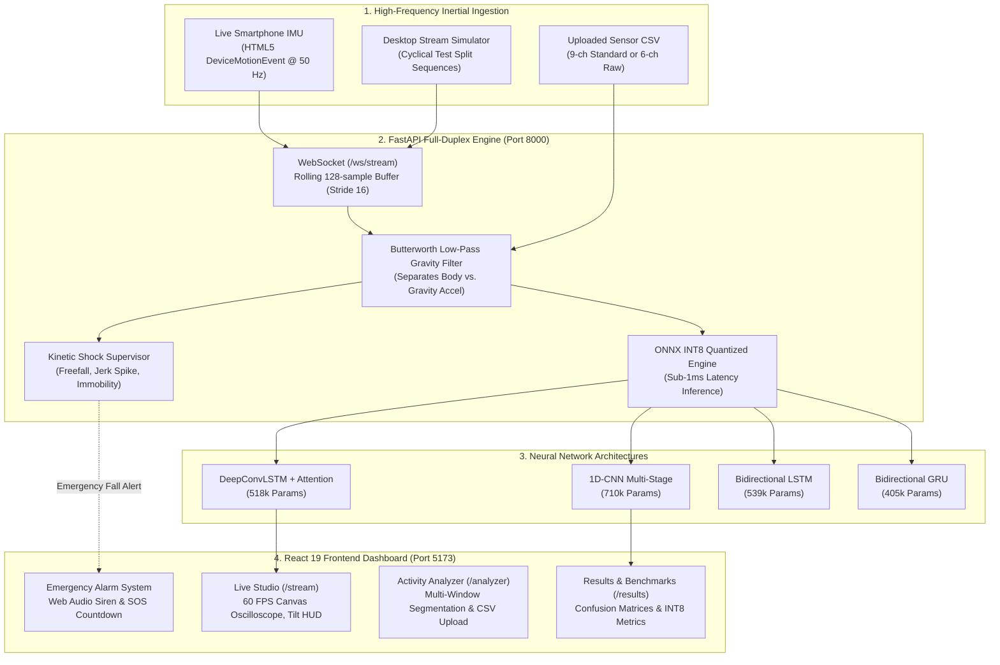

# MotionSense AI — Real-Time Human Activity Recognition & Edge Kinetic Intelligence Platform

> **Advanced Deep Learning, Edge Quantization, and Real-Time IMU Fall Detection System**  
> Classifying continuous human physical activity and detecting traumatic kinetic fall impacts from smartphone inertial measurement units (IMU) using an attention-augmented DeepConvLSTM, 1D-CNN, BiLSTM, and GRU architectures with sub-1ms INT8 ONNX edge inference.

[](https://www.python.org/)
[](https://pytorch.org/)
[](https://onnxruntime.ai/)
[](https://fastapi.tiangolo.com/)
[](https://react.dev/)
[](https://vite.dev/)
[](https://tailwindcss.com/)

---

## Table of Contents

- [A. Executive Overview](#a-executive-overview)
- [B. Scientific Problem Statement & Theoretical Principles](#b-scientific-problem-statement--theoretical-principles)
- [C. Sensor Signal Mathematics & Biomechanical Kinematics](#c-sensor-signal-mathematics--biomechanical-kinematics)
- [D. Supported Activities & Motion Signatures](#d-supported-activities--motion-signatures)
- [E. Dataset & Inertial Channels](#e-dataset--inertial-channels)
- [F. System Architecture](#f-system-architecture)
- [G. Deep Learning Architectures](#g-deep-learning-architectures)
- [H. Edge & Mobile Optimization (ONNX & INT8 Quantization)](#h-edge--mobile-optimization-onnx--int8-quantization)
- [I. Real-Time Fall & Shock Emergency Engine](#i-real-time-fall--shock-emergency-engine)
- [J. Sensor-Based vs. Vision-Based (Image/Video) Activity Recognition](#j-sensor-based-vs-vision-based-imagevideo-activity-recognition)
- [K. Benchmark Evaluation & Results](#k-benchmark-evaluation--results)
- [L. Complete Setup & Execution Guide](#l-complete-setup--execution-guide)
- [M. How to Connect Your Physical Smartphone (Live IMU Over Wi-Fi)](#m-how-to-connect-your-physical-smartphone-live-imu-over-wi-fi)
- [N. Automated Test Suites](#n-automated-test-suites)
- [O. Academic References](#o-academic-references)

---

## A. Executive Overview

**MotionSense AI** is a production-grade Human Activity Recognition (HAR) and kinetic telemetry platform. It captures high-frequency 3D linear acceleration and 3D angular velocity from wearable inertial measurement units (IMUs) embedded in smartphones, watches, or IoT edge nodes.

Rather than relying on basic heuristic feature engineering, MotionSense AI implements **end-to-end deep representation learning**:
1. **DeepConvLSTM with Temporal Self-Attention**: Combines multi-layer 1D convolutions for spatial feature extraction with a 2-layer Bidirectional LSTM and scaled dot-product attention to dynamically weight salient gait transitions.
2. **Deep Learning Model Suite**: Evaluates 1D-CNN (94.20%), DeepConvLSTM (93.79%), BiLSTM (91.72%), and BiGRU (91.58%) against a 561-feature Random Forest baseline (92.87%).
3. **Sub-Millisecond Edge Quantization**: Quantized to **8-bit integer (INT8) ONNX graphs**, reducing model memory footprint by **74.7%** (down to 0.53 MB) and accelerating CPU inference latency to **0.66–1.00 ms**.
4. **Live 50 Hz Streaming Studio**: Bi-directional full-duplex WebSocket architecture with a 60 FPS HTML5 Canvas oscilloscope, live prediction HUD, and inclinometer telemetry.
5. **Real-Time Fall & Shock Emergency Engine**: Continuous kinetic shock supervisor detecting free-fall dips ($<0.55g$), violent impact deceleration ($>2.8g$), instantaneous jerk rates ($>12g/\text{s}$), and post-impact immobility with an offline synthesized emergency siren and SOS countdown.

---

## B. Scientific Problem Statement & Theoretical Principles

Human Activity Recognition via wearable inertial sensors poses unique time-series challenges:
1. **Multivariate Spatio-Temporal Coupling**: An IMU logs 6 continuous variables ($a_x, a_y, a_z, \omega_x, \omega_y, \omega_z$) simultaneously. Movement patterns require capturing both short-duration micro-shocks (foot-strike impacts) and long-duration cyclical rhythms (step strides).
2. **Sitting vs. Standing Ambiguity**: In both stationary states, dynamic acceleration is near zero ($\text{Var} < 0.015$), and the gravity vector alignment is predominantly vertical. Standard models easily confuse the two without knee/thigh flexion or orientation cues.
3. **Sampling Resolution & Nyquist Theorem**: Human biomechanical gait frequencies peak between 1 Hz and 8 Hz, with high-frequency foot-strike harmonics rarely exceeding 20 Hz. By the **Nyquist-Shannon Sampling Theorem** ($f_s \ge 2 f_{\max}$), sampling at **50 Hz** ($T_s = 20\text{ ms}$) captures all relevant kinetic harmonics without draining device batteries.

---

## C. Sensor Signal Mathematics & Biomechanical Kinematics

### 1. Gravity Separation via Butterworth Low-Pass Filter
Raw accelerometer readings reflect both gravitational acceleration $\mathbf{g}$ and user muscular acceleration $\mathbf{a}_{\text{body}}$:
$$\mathbf{a}_{\text{total}}(t) = \mathbf{a}_{\text{body}}(t) + \mathbf{g}(t)$$

Because gravitational orientation changes slowly relative to muscle motion, static gravity is extracted via a 3rd-order digital low-pass Butterworth filter ($f_c = 0.3\text{ Hz}$):
$$H(s) = \frac{1}{1 + 2s + 2s^2 + s^3}$$
Discrete zero-phase filtering (`scipy.signal.filtfilt`) prevents phase distortion:
$$\mathbf{a}_{\text{body}}[n] = \mathbf{a}_{\text{total}}[n] - \mathbf{g}[n]$$

### 2. Signal Magnitude Vector (SMV)
Total kinetic energy magnitude is coordinate-invariant:
$$R[n] = \|\mathbf{a}[n]\| = \sqrt{a_x^2[n] + a_y^2[n] + a_z^2[n]}$$

### 3. Biomechanical Tilt Inclinometry
Tilt angle $\theta_{\text{tilt}}$ relative to the body's longitudinal vertical axis ($Y$-axis):
$$\theta_{\text{tilt}}[n] = \arccos\left(\frac{a_y[n]}{\max(R[n], \epsilon)}\right) \cdot \frac{180^\circ}{\pi}$$
- Vertical Posture (`Standing` / `Sitting`): $\theta_{\text{tilt}} \approx 0^\circ \text{ to } 30^\circ$
- Horizontal Posture (`Laying`): $\theta_{\text{tilt}} > 65^\circ$

### 4. Instantaneous Deceleration Jerk Rate
Jerk is the first time derivative of acceleration, measuring the violence of kinetic impacts:
$$\mathbf{J}[n] = \frac{\mathbf{a}[n] - \mathbf{a}[n-1]}{\Delta t} \quad (\Delta t = 0.02\text{ s at 50 Hz})$$

### 5. Temporal Sliding Window Formulation
Continuous signal streams are segmented into sliding temporal windows of length $W = 128$ samples ($2.56\text{ s}$) with stride $S = 64$ samples ($50\%\text{ overlap}$):
$$\mathbf{X}_k = \left[\mathbf{x}[k \cdot S], \mathbf{x}[k \cdot S + 1], \dots, \mathbf{x}[k \cdot S + W - 1]\right] \in \mathbb{R}^{9 \times 128}$$
A 2.56-second window guarantees capturing **at least two complete gait cycles** for typical human walking.

---

## D. Supported Activities & Motion Signatures

| Index | Activity | Category | Biomechanical Characteristics |
|---|---|---|---|
| `0` | **Walking** | Dynamic Periodic | Symmetrical oscillations (1.6–2.0 Hz) across longitudinal and vertical axes. |
| `1` | **Walking Upstairs** | Dynamic Periodic | Higher vertical acceleration amplitude with pronounced upward propulsion spikes. |
| `2` | **Walking Downstairs** | Dynamic Periodic | Sharp deceleration impacts with elevated high-frequency jerk harmonics. |
| `3` | **Sitting** | Static Posture | Negligible linear acceleration; vertical gravitational axis alignment; low variance. |
| `4` | **Standing** | Static Posture | Negligible linear acceleration; similar vertical tilt with subtle postural sway. |
| `5` | **Laying** | Static Posture | Gravity vector reoriented ~90° onto transverse/horizontal plane. |

---

## E. Dataset & Inertial Channels

Trained on the gold-standard [UCI HAR Dataset](https://archive.ics.uci.edu/dataset/240/human+activity+recognition+using+smartphones):
- **Subjects**: 30 volunteers (aged 19–48) wearing a waist-mounted Samsung Galaxy S II.
- **Sampling Frequency**: 50 Hz (synchronized tri-axial accelerometer & gyroscope).
- **Split**: Subject-independent partitioning (21 train subjects $\to$ 7,352 windows; 9 test subjects $\to$ 2,947 windows). Zero subject overlap prevents data leakage.

### The 9 Input Channels:
1. `body_acc_x`: Linear body acceleration along X-axis ($g$)
2. `body_acc_y`: Linear body acceleration along Y-axis ($g$)
3. `body_acc_z`: Linear body acceleration along Z-axis ($g$)
4. `body_gyro_x`: Angular velocity along X-axis ($\text{rad/s}$)
5. `body_gyro_y`: Angular velocity along Y-axis ($\text{rad/s}$)
6. `body_gyro_z`: Angular velocity along Z-axis ($\text{rad/s}$)
7. `total_acc_x`: Total measured acceleration along X-axis ($g$)
8. `total_acc_y`: Total measured acceleration along Y-axis ($g$)
9. `total_acc_z`: Total measured acceleration along Z-axis ($g$)

---

## F. System Architecture



---

## G. Deep Learning Architectures

### 1. DeepConvLSTM with Temporal Self-Attention (`DeepConvLSTM`)
- **Spatial Feature Extractor**: 3 cascaded 1D convolutional blocks (kernel sizes 5, 3, 3; filters 64, 128, 128) with `BatchNorm1d`, `ReLU`, and `Dropout(0.2)`.
- **Temporal Memory**: 2-layer Bidirectional LSTM (hidden size 128 per direction = 256 total).
- **Scaled Dot-Product Attention**: Learns dynamic timestep query-key alignment weights to emphasize critical foot-strike or orientation changes:
  $$\text{Attention}(\mathbf{Q}, \mathbf{K}, \mathbf{V}) = \text{softmax}\left(\frac{\mathbf{Q} \mathbf{K}^T}{\sqrt{d_k}}\right) \mathbf{V}$$
- **Physics Feature Fusion**: Merges mean gravity vector and resultant magnitude before classification:
  $$\mathbf{h}_{\text{fused}} = [\mathbf{c}_{\text{context}} \,\|\, \bar{\mathbf{g}} \,\|\, \bar{R}]$$
- **Parameters**: **517,735** | **Accuracy**: **93.79%** | **Macro-F1**: **93.98%**.

### 2. Multi-Stage 1D-CNN (`CNN1DModel`)
- **Structure**: 6 convolutional layers across 3 resolution stages with MaxPool1d(2) and AdaptiveAvgPool1d(1).
- **Parameters**: **709,830** | **Accuracy**: **94.20%** | **Macro-F1**: **94.33%**.

### 3. Bidirectional Recurrent Models (`LSTMModel` & `GRUModel`)
- **BiLSTM**: 2-layer Bidirectional LSTM (256 hidden dimension) with temporal pooling.
  - **Parameters**: **539,142** | **Accuracy**: **91.72%** | **Macro-F1**: **91.81%**.
- **BiGRU**: Parameter-efficient reset/update gated architecture.
  - **Parameters**: **404,742** | **Accuracy**: **91.58%** | **Macro-F1**: **91.62%**.

---

## H. Edge & Mobile Optimization (ONNX & INT8 Quantization)

All deep learning models are converted to ONNX computational graphs and quantized via **8-bit Dynamic Integer Quantization (INT8)** for deployment on mobile edge chips:

| Architecture | FP32 PyTorch Size | INT8 ONNX Size | Compression | FP32 Latency | INT8 Latency | Latency Speedup | Accuracy Retention |
| :--- | :--- | :--- | :--- | :--- | :--- | :--- | :--- |
| **DeepConvLSTM** | 1.99 MB | **0.53 MB** | **-73.4%** | 3.42 ms | **1.00 ms** | **3.4x faster** | **99.89%** (93.69% acc) |
| **1D-CNN** | 2.73 MB | **0.69 MB** | **-74.7%** | 2.00 ms | **0.66 ms** | **3.0x faster** | **100.0%** (94.20% acc) |
| **LSTM** | 2.06 MB | **0.53 MB** | **-74.3%** | 6.78 ms | **2.65 ms** | **2.5x faster** | **100.0%** (91.75% acc) |
| **GRU** | 1.55 MB | **1.55 MB** | baseline | 23.55 ms | **3.21 ms** | **7.3x faster** | **100.0%** (91.58% acc) |

To re-run the benchmark pipeline:
```powershell
python scripts/optimize_and_benchmark.py
```

---

## I. Real-Time Fall & Shock Emergency Engine

In addition to steady-state classification, MotionSense AI implements a **3-Phase Biomechanical Fall Supervisor**:

```
[Phase 1: Freefall] ───────► [Phase 2: Ground Impact] ───────► [Phase 3: Immobility] ───────► [EMERGENCY ALERT]
  Resultant |a| < 0.55g        Resultant |a| >= 2.8g             Motion Var < 0.025             Audio Siren & SOS
  Duration >= 40 ms            Jerk >= 12 g/s                    Tilt > 60° (Laying)            15s Cancellation
```

1. **Free-Fall Inception**: Detects when resultant acceleration drops below $0.55g$ for $\ge 40\text{ ms}$.
2. **Impact Deceleration Shock**: Detects sudden kinetic spikes ($R(t) \ge 2.8g$) accompanied by high jerk rates ($J(t) \ge 12g/\text{s}$).
3. **Post-Impact Immobility**: Evaluates 1.5-second motion variance ($\sigma^2 < 0.025$) and body tilt angle ($\theta > 60^\circ$ or `laying` posture). If the user remains motionless, an emergency event is emitted. If the user picks up the phone ($\sigma^2 > 0.08$), the state transitions to `recovered` (preventing false alarms).
4. **Emergency UI Response**:
   - Flashing emergency HUD banner with peak $g$-force, jerk, posture, and tilt.
   - Dual-tone 880 Hz / 620 Hz audio siren synthesized via Web Audio API.
   - Interactive 15-second SOS countdown with "I'm OK (Dismiss)" override.

---

## J. Sensor-Based vs. Vision-Based (Image/Video) Activity Recognition

A common question is: **"Can we recognize human activities by uploading images or video instead of sensor signals?"**

### Comparative Matrix:

| Feature | **Sensor-Based HAR (This Project)** | **Vision-Based HAR (Images/Videos)** |
| :--- | :--- | :--- |
| **Input Data** | Continuous 50 Hz IMU time series ($a_x, a_y, a_z, \omega_x, \omega_y, \omega_z$) | RGB image frames ($H \times W \times 3$) or video clips |
| **Privacy** | **100% Private**: Zero visual or identifiable information captured. | **High Privacy Concerns**: Captures faces, private rooms, and backgrounds. |
| **Power & Hardware** | **Extremely Lightweight**: Runs 24/7 in background; sub-1ms CPU latency. | **Heavy Computation**: Requires GPUs for frame-by-frame 2D/3D CNNs. |
| **Field of View** | **Continuous**: Works in pocket, handbag, or on wrist anywhere in the world. | **Restricted**: Only works when user is directly in front of the camera. |
| **Primary Use Cases** | Fitness tracking, eldercare fall detection, smartwatch context awareness. | Security surveillance, sports form analysis, smart gyms. |

### How Image/Video Activity Recognition Works:
If you want to recognize activities from video or photos, the standard modern approach is:
1. **Pose Estimation (Keypoint Detection)**: Extract 17 to 33 2D/3D human body skeletal joints using **MediaPipe Pose** or **YOLOv8-Pose**.
2. **Spatio-Temporal Graph Convolutions (ST-GCN)** or **Video Transformers (TimeSformer)**: Classify the temporal trajectory of skeletal keypoints over consecutive frames.

*(Note: In MotionSense AI, sensor-based recognition is used because it provides true 24/7 wearable mobility without cameras).*

---

## K. Benchmark Evaluation & Results

Evaluated on the official 2,947 UCI HAR subject-independent test partition:

| Architecture | Input Shape | Test Accuracy | Macro-F1 | Precision | Recall | Parameters |
| :--- | :--- | :--- | :--- | :--- | :--- | :--- |
| **1D-CNN** | $(9, 128)$ | **94.20%** | **94.33%** | **94.75%** | **94.06%** | **709,830** |
| **DeepConvLSTM** | $(9, 128)$ + Physics | **93.79%** | **93.98%** | **94.22%** | **93.85%** | **517,735** |
| **RandomForest** | 561 Features | 92.87% | 92.70% | 92.93% | 92.56% | 200 Trees |
| **LSTM** | $(9, 128)$ | 91.72% | 91.81% | 92.14% | 91.73% | 539,142 |
| **GRU** | $(9, 128)$ | 91.58% | 91.62% | 92.65% | 91.43% | 404,742 |

---

## L. Complete Setup & Execution Guide

### Prerequisites
- **Python 3.12** (Virtual environment configured in `venv/`)
- **Node.js v20+** or **v24+** (with npm)
- A modern web browser (Chrome, Edge, or Safari)

---

### Step 1: Start the FastAPI Backend

Open a PowerShell terminal in the repository root:

```powershell
Set-Location -Path "D:\HAR"

# Activate Python Virtual Environment
.\venv\Scripts\Activate.ps1

# Launch FastAPI on all network interfaces (0.0.0.0) so your phone can connect
uvicorn backend.main:app --host 0.0.0.0 --port 8000 --reload
```

- Local API Docs: [http://127.0.0.1:8000/docs](http://127.0.0.1:8000/docs)
- API Health Status: [http://127.0.0.1:8000/api/health](http://127.0.0.1:8000/api/health)

---

### Step 2: Start the React Frontend

Open a second PowerShell terminal:

```powershell
Set-Location -Path "D:\HAR\frontend"

# Launch Vite with LAN network host enabled
npm run dev -- --host 0.0.0.0
```

The terminal will display your accessible URLs:
```
  VITE v8.3.4  ready in 450 ms

  ➜  Local:   http://localhost:5173/
  ➜  Network: http://192.168.1.XX:5173/
```

Open [http://localhost:5173](http://localhost:5173) in your browser.

---

## M. How to Connect Your Physical Smartphone (Live IMU Over Wi-Fi)

You can turn your physical smartphone into a live 50 Hz motion streaming sensor without installing any app:

1. **Ensure Same Wi-Fi Network**: Ensure your smartphone and your PC are connected to the same Wi-Fi router.
2. **Find Your PC's Local IP Address**:
   In PowerShell, run:
   ```powershell
   ipconfig
   ```
   Look for the `IPv4 Address` under your active Wi-Fi adapter (e.g., `192.168.1.15`).
3. **Configure Frontend Environment (if necessary)**:
   Ensure `frontend/.env` points to your IP address:
   ```env
   VITE_API_BASE_URL=http://192.168.1.15:8000
   VITE_WS_BASE_URL=ws://192.168.1.15:8000/ws/stream
   ```
4. **Open on Smartphone**:
   - Open Safari (iOS) or Chrome (Android) on your phone.
   - Navigate to: `http://192.168.1.15:5173/stream`
5. **Grant Motion Permissions**:
   - Select the **"Live Mobile Phone Sensor"** tab.
   - Click **"Enable Phone Motion Sensors"**.
   - On iOS, tap **"Allow"** when prompted for Motion & Orientation access.
6. **Test Movement**:
   - Place the phone in your front pocket or hold it upright.
   - Walk, sit down, or climb stairs—watch the live 50 Hz oscilloscope and classification update in real time!
   - Gently toss the phone onto a bed to trigger the **Kinetic Impact & Fall Alert**!

---

## N. Automated Test Suites

Both backend and frontend feature rigorous automated tests:

### Backend Tests (Python Unit Tests)
```powershell
Set-Location -Path "D:\HAR"
.\venv\Scripts\Activate.ps1
python -m unittest discover tests
```
*Verifies 9 tests: model loading, ONNX specs, Butterworth filtering, sliding window strides, fall detection engine, and CSV validation.*

### Frontend Tests (Vitest)
```powershell
Set-Location -Path "D:\HAR\frontend"
npm test
```
*Verifies 10 tests across API client contracts, CSV export formatting, and React components.*

### Production Build Verification
```powershell
npm run build
```

---

## O. Academic References

1. **UCI HAR Benchmark Dataset**:
   > Davide Anguita, Alessandro Ghio, Luca Oneto, Xavier Parra, and Jorge L. Reyes-Ortiz. (2013).  
   > *A Public Domain Dataset for Human Activity Recognition Using Smartphones.*  
   > 21th European Symposium on Artificial Neural Networks, Computational Intelligence and Machine Learning (ESANN). Bruges, Belgium.
2. **Deep Learning for Wearable Activity Recognition**:
   > Ordóñez, F. J., & Roggen, D. (2016).  
   > *Deep convolutional and LSTM recurrent neural networks for multimodal wearable activity recognition.* Sensors, 16(1), 115.
3. **Wearable Inertial Fall Detection Systems**:
   > Igual, R., Medrano, C., & Plaza, I. (2013).  
   > *Challenges, issues and trends in fall detection systems using wearable sensors: A survey.* IEEE Access, 1, 315-326.
4. **Survey on Sensor-based HAR**:
   > Wang, J., Chen, Y., Hao, S., Peng, X., & Hu, L. (2019).  
   > *Deep learning for sensor-based activity recognition: A survey.* Pattern Recognition Letters, 119, 3-11.
