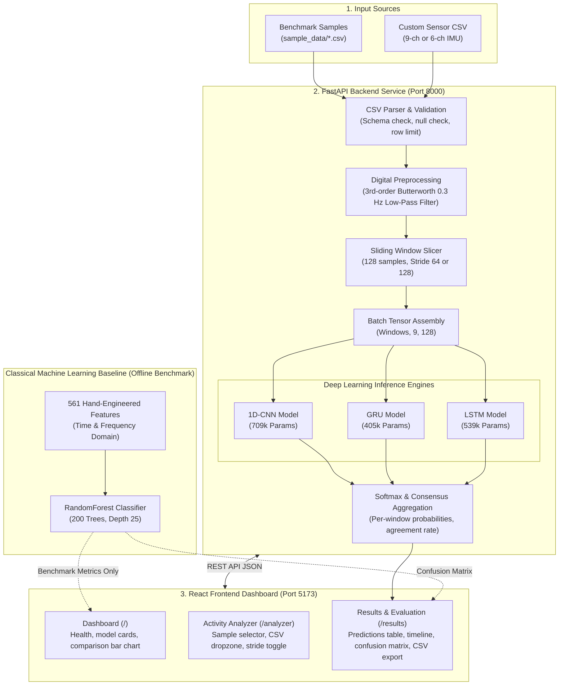

# MotionSense AI — Deep Learning-Based Human Activity Recognition

> **An Academic Deep Learning Mini-Project**  
> Classifying six fundamental human activities from smartphone inertial measurement unit (IMU) signals by evaluating 1D-CNN, Bidirectional GRU, and Bidirectional LSTM architectures against a classical machine learning baseline.

[](https://www.python.org/)
[](https://pytorch.org/)
[](https://fastapi.tiangolo.com/)
[](https://react.dev/)
[](https://vite.dev/)
[](https://tailwindcss.com/)

---

> [!IMPORTANT]
> **Academic Mini-Project Scope & Disclaimer**: MotionSense AI is an academic machine-learning coursework project developed to demonstrate time-series classification, digital signal filtering, and neural architecture comparison. It is **not** certified for clinical patient diagnostics, medical triage, emergency response alerts, or safety-critical fall-detection applications.

---

## Table of Contents

- [A. Project Title and Overview](#a-project-title-and-overview)
- [B. Problem Statement](#b-problem-statement)
- [C. Objectives](#c-objectives)
- [D. Supported Activities](#d-supported-activities)
- [E. Dataset & Inertial Signals](#e-dataset--inertial-signals)
- [F. System Architecture](#f-system-architecture)
- [G. Deep Learning Architectures](#g-deep-learning-architectures)
- [H. Classical Machine Learning Baseline](#h-classical-machine-learning-baseline)
- [I. Technology Stack](#i-technology-stack)
- [J. Repository Structure](#j-repository-structure)
- [K. Data Processing and Inference Pipeline](#k-data-processing-and-inference-pipeline)
- [L. Model Evaluation & Benchmark Results](#l-model-evaluation--benchmark-results)
- [M. Application Features](#m-application-features)
- [N. Installation and Setup Guide](#n-installation-and-setup-guide)
- [O. How to Demonstrate (Step-by-Step)](#o-how-to-demonstrate-step-by-step)
- [P. System Limitations](#p-system-limitations)
- [Q. Future Improvements](#q-future-improvements)
- [R. Academic References](#r-academic-references)

---

## A. Project Title and Overview

**MotionSense AI** is a Deep Learning-based Human Activity Recognition (HAR) system that classifies physical human activities from smartphone inertial sensors (tri-axial accelerometer and tri-axial gyroscope).

Modern smartphones embed micro-electro-mechanical systems (MEMS) sensors that capture 3D acceleration and angular velocity as people move. Because distinct physical motions produce characteristic temporal signatures—periodic cyclical waveforms for walking, asymmetric high-impact impulses for stair descent, and static gravitational alignments for resting postures—smartphone inertial signals provide a rich medium for activity recognition without requiring visual surveillance or specialized hardware.

This project was built as an academic **Deep Learning mini-project** to compare end-to-end representation learning (1D-CNN, GRU, LSTM) on raw sensor sequences against traditional heuristic feature-engineering methods.

---

## B. Problem Statement

Human Activity Recognition from wearable sensor streams faces several key challenges:
1. **Multivariate Temporal Dependencies**: Sensor data comprises multiple continuous axes sampled simultaneously at 50 Hz. Recognizing movement requires capturing both short-term temporal correlations (e.g., individual foot strikes) and longer sequence dynamics (e.g., periodic gait cycles).
2. **Heuristic Bottleneck vs. End-to-End Learning**: Classical HAR pipelines rely on extracting hundreds of hand-crafted statistical and frequency-domain features (mean, variance, FFT coefficients, energy) across window intervals. This process is complex, domain-specific, and computationally heavy. Comparing convolutional (shift-invariant feature extraction) and recurrent (sequential state propagation) neural networks reveals whether raw sensor data can be learned directly with equal or superior accuracy.
3. **Postural Ambiguity (Sitting vs. Standing)**: Distinguishing stationary postures where dynamic linear acceleration is near zero and device orientation relative to gravity is nearly identical represents a significant classification hurdle.

---

## C. Objectives

- **Classify Six Fundamental Activities**: Accurately recognize walking, stair climbing, stair descent, sitting, standing, and laying.
- **Implement Robust Sensor Preprocessing**: Support 9-channel pre-separated inputs and 6-channel raw IMU inputs with automated digital Butterworth low-pass filtering for static gravity extraction.
- **Window Segmentation**: Segment continuous time-series streams into fixed 128-sample windows (2.56 seconds at 50 Hz) with configurable stride (64 samples for 50% overlap, 128 samples for non-overlapping).
- **Evaluate Three Deep Learning Architectures**: Train, checkpoint, and compare 1D-CNN, Bidirectional GRU, and Bidirectional LSTM models on raw sequences.
- **Benchmark Against Classical ML**: Compare deep models against a 200-tree Random Forest baseline trained on 561 engineered features.
- **RESTful Inference Service**: Expose inference, sample inspection, and evaluation telemetry via an asynchronous FastAPI backend.
- **Interactive React Demonstration Interface**: Provide a clean, modern three-page React frontend for evaluating benchmark samples and custom CSV uploads.

---

## D. Supported Activities

The models classify each 128-sample sensor window into one of six target activities:

| Class Index | Activity Key | Display Label | Motion Category | Biomechanical Signature |
|---|---|---|---|---|
| `0` | `walking` | Walking | Dynamic Periodic | Regular cyclic oscillations across longitudinal and vertical acceleration axes |
| `1` | `walking-upstairs` | Walking Upstairs | Dynamic Periodic | Higher acceleration amplitude with asymmetric upward push impulses |
| `2` | `walking-downstairs` | Walking Downstairs | Dynamic Periodic | Rapid downward impact spikes with higher high-frequency variance |
| `3` | `sitting` | Sitting | Static Posture | Near-zero linear acceleration; vertical gravitational axis alignment |
| `4` | `standing` | Standing | Static Posture | Near-zero linear acceleration; orientation similar to sitting |
| `5` | `laying` | Laying | Static Posture | Gravitational acceleration vector reoriented by ~90° onto horizontal axes |

---

## E. Dataset & Inertial Signals

The project utilizes the benchmark [UCI Human Activity Recognition Using Smartphones Dataset](https://archive.ics.uci.edu/dataset/240/human+activity+recognition+using+smartphones) (Anguita et al., 2013).

- **Subjects**: 30 volunteers aged 19–48 years performing activities wearing a waist-mounted Samsung Galaxy S II.
- **Sensors**: Tri-axial accelerometer and tri-axial gyroscope recorded continuously at **50 Hz** (1 sample every 20 ms).
- **Windowing**: 128 readings (2.56 seconds) per window with 50% overlap (64 readings stride).
- **Partitioning (Subject-Independent)**:
  - **Training Set**: 21 subjects (70%) $\to$ **7,352 windows**.
  - **Test Set**: 9 subjects (30%; IDs: 2, 4, 9, 10, 12, 13, 18, 20, 24) $\to$ **2,947 windows**.
  - *No subject appears in both splits*, preventing subject data leakage.

### The 9 Raw Sensor Channels

Each window is represented as a matrix of shape `(9, 128)`:
1. `body_acc_x`: Body linear acceleration along X-axis (Earth $g$, gravity filtered out)
2. `body_acc_y`: Body linear acceleration along Y-axis (Earth $g$, gravity filtered out)
3. `body_acc_z`: Body linear acceleration along Z-axis (Earth $g$, gravity filtered out)
4. `body_gyro_x`: Angular velocity along X-axis ($\text{rad/s}$)
5. `body_gyro_y`: Angular velocity along Y-axis ($\text{rad/s}$)
6. `body_gyro_z`: Angular velocity along Z-axis ($\text{rad/s}$)
7. `total_acc_x`: Total measured acceleration along X-axis (Body + Gravity, Earth $g$)
8. `total_acc_y`: Total measured acceleration along Y-axis (Body + Gravity, Earth $g$)
9. `total_acc_z`: Total measured acceleration along Z-axis (Body + Gravity, Earth $g$)

---

## F. System Architecture

The following diagram illustrates the complete end-to-end data processing and model inference pipeline:



---

## G. Deep Learning Architectures

All three deep models take as input a tensor of shape `(Batch, 9, 128)` and project to `(Batch, 6)` class logits.

### 1. 1D Convolutional Neural Network (`CNN1DModel`)
- **Concept**: Applies 1D temporal convolutions across the sensor channels to capture local shift-invariant temporal wavelets and impact transitions.
- **Layers**:
  - Block 1: `Conv1d(9, 64, k=9, p=4)` $\to$ `BatchNorm1d` $\to$ `ReLU` $\to$ `Conv1d(64, 64, k=9, p=4)` $\to$ `BatchNorm1d` $\to$ `ReLU` $\to$ `MaxPool1d(2)` (128 $\to$ 64 timesteps).
  - Block 2: `Conv1d(64, 128, k=7, p=3)` $\to$ `BatchNorm1d` $\to$ `ReLU` $\to$ `Conv1d(128, 128, k=7, p=3)` $\to$ `BatchNorm1d` $\to$ `ReLU` $\to$ `MaxPool1d(2)` (64 $\to$ 32 timesteps).
  - Block 3: `Conv1d(128, 256, k=5, p=2)` $\to$ `BatchNorm1d` $\to$ `ReLU` $\to$ `Conv1d(256, 256, k=5, p=2)` $\to$ `BatchNorm1d` $\to$ `ReLU` $\to$ `AdaptiveAvgPool1d(1)`.
  - Classifier Head: `Dropout(0.3)` $\to$ `Linear(256, 6)`.
- **Parameters**: **709,830** (~2.72 MB checkpoint).
- **Test Accuracy**: **94.20%** | **Macro-F1**: **94.33%**.

### 2. Gated Recurrent Unit (`GRUModel`)
- **Concept**: Models sequential dependencies across time using reset and update gating units, offering parameter efficiency and fast convergence.
- **Layers**:
  - Input permuted from `(B, 9, 128)` to `(B, 128, 9)`.
  - 2-layer Bidirectional GRU (128 hidden units per direction; total hidden dimension = 256), dropout = 0.3.
  - Temporal average pooling across the 128 timesteps (`out.mean(dim=1)`).
  - Projection: `Linear(256, 6)`.
- **Parameters**: **404,742** (~1.55 MB checkpoint).
- **Test Accuracy**: **91.58%** | **Macro-F1**: **91.62%**.

### 3. Long Short-Term Memory (`LSTMModel`)
- **Concept**: Maintains separate cell states and hidden states across forward and reverse sequence directions to capture long-range contextual dependencies.
- **Layers**:
  - Input permuted to `(B, 128, 9)`.
  - 2-layer Bidirectional LSTM (128 hidden units per direction; total hidden dimension = 256), dropout = 0.3.
  - Temporal average pooling across the 128 timesteps.
  - Projection: `Linear(256, 6)`.
- **Parameters**: **539,142** (~2.07 MB checkpoint).
- **Test Accuracy**: **91.72%** | **Macro-F1**: **91.81%**.

---

## H. Classical Machine Learning Baseline

To evaluate whether deep representation learning on raw signals is justified, the pipeline includes a **Random Forest Classifier** (`RandomForestClassifier`):
- **Configuration**: 200 decision trees, maximum tree depth of 25.
- **Input Features**: 561 pre-engineered time-domain and frequency-domain features (statistical moments, correlation coefficients, signal magnitude area, energy bands, autoregression coefficients).
- **Benchmark Performance**: **92.87%** Test Accuracy | **92.70%** Macro-F1.
- **Key Insight**: The 1D-CNN (**94.20%**) outperforms the Random Forest baseline (**92.87%**) despite receiving zero hand-crafted mathematical features, demonstrating that raw temporal convolutions extract superior task-specific representations.

---

## I. Technology Stack

- **Machine Learning & Signal Processing**:
  - `Python 3.12`
  - `PyTorch 2.13.0` (neural network architectures, autograd, checkpointing)
  - `Scikit-Learn 1.9.0` (RandomForest baseline, evaluation metrics, confusion matrix)
  - `NumPy 2.4.6` (tensor and array manipulations)
  - `SciPy` (`scipy.signal.butter`, `filtfilt` for zero-phase digital filtering)
- **Backend API Service**:
  - `FastAPI 0.115+` (asynchronous high-performance REST API)
  - `Uvicorn 0.30+` (ASGI web server)
  - `Pydantic 2.9+` (typed request validation and response schemas)
  - `python-multipart` (streaming CSV file upload handling)
- **Frontend Demonstration Dashboard**:
  - `React 19.2` (declarative user interface)
  - `TypeScript 5.7+` (end-to-end type safety)
  - `Vite 8.3` (fast build tool and dev server)
  - `Tailwind CSS 4.3` (zero-runtime dark research dashboard styling)
  - `Recharts 3.10` (declarative SVG charts for accuracy, confidence, and timelines)
  - `Lucide React` (modern system iconography)
- **Alternative Interface**:
  - `Streamlit 1.61.1` (existing exploratory multi-tab application in `app.py`)

---

## J. Repository Structure

```
D:\HAR\
├── .gitignore                         # Git exclusion rules (venv, datasets, .env, build output)
├── README.md                          # Root technical project documentation (this file)
├── requirements.txt                   # Core Python dependencies
├── runtime.txt                        # Target Python runtime (python-3.12)
├── app.py                             # Operational Streamlit multi-tab dashboard
├── har.py                             # Model training pipeline & CLI entry point
├── har.ipynb                          # Interactive exploratory research notebook
├── backend/                           # FastAPI REST API Backend
│   ├── __init__.py                    # Module export definitions
│   ├── main.py                        # FastAPI endpoints, CORS, lifecycle management
│   ├── inference.py                   # Decoupled inference engine & Butterworth filter
│   ├── schemas.py                     # Pydantic v2 data models & request/response schemas
│   └── requirements.txt               # Backend dependencies (fastapi, uvicorn, pydantic)
├── data/                              # Benchmark dataset directory
│   └── UCI HAR Dataset/               # UCI HAR benchmark dataset (7,352 train / 2,947 test)
├── out/                               # Serialized models and evaluation artifacts
│   ├── cnn1d_best.pt                  # Trained 1D-CNN weights (709k params, ~2.72 MB)
│   ├── gru_best.pt                    # Trained GRU weights (404k params, ~1.55 MB)
│   ├── lstm_best.pt                   # Trained LSTM weights (539k params, ~2.07 MB)
│   └── metrics.json                   # Verified evaluation metrics, confusion matrices, loss curves
├── sample_data/                       # Pre-packaged test recordings & CSV templates
│   ├── sample_walking_128.csv         # 128-row verified walking sample (single window)
│   ├── sample_sitting_128.csv         # 128-row verified sitting sample (single window)
│   ├── sample_stairs_multiwindow_384.csv # 384-row verified walking-upstairs sample (multi-window)
│   ├── template_6ch_imu.csv           # 6-channel raw IMU template schema
│   └── template_9ch_schema.csv        # 9-channel pre-separated template schema
├── tests/                             # Automated backend regression & inference tests
│   └── test_inference.py              # Unit tests for preprocessing, windowing, and models
└── frontend/                          # React + TypeScript + Vite Frontend Application
    ├── .env.example                   # API base URL configuration template
    ├── package.json                   # React dependencies and test scripts
    ├── vite.config.ts                 # Vite + Tailwind + Vitest configuration
    ├── README.md                      # Frontend-specific documentation
    └── src/
        ├── types/api.ts               # Strict TypeScript API contracts
        ├── api/client.ts              # Axios service client with error formatting
        ├── context/AnalysisContext.tsx # Shared session state for active prediction responses
        ├── utils/csvExport.ts         # RFC 4180 CSV export utility
        ├── components/                # Navbar, Sidebar, MetricCard, ActivityBadge, charts
        └── pages/
            ├── DashboardPage.tsx      # Route: / (Overview & model benchmark cards)
            ├── AnalyzerPage.tsx       # Route: /analyzer (Benchmark & custom CSV inference)
            └── ResultsPage.tsx        # Route: /results (Predictions, timeline, confusion matrix)
```

---

## K. Data Processing and Inference Pipeline

The inference pipeline follows an eight-stage sequence:

1. **Input CSV Validation**: The uploaded file or benchmark sample is verified to be a valid comma-separated text file. Empty files, files exceeding 50,000 rows, or files containing missing/non-numeric values are rejected with informative error messages.
2. **Channel & Schema Detection**:
   - **Option A (9-Channel Standard)**: Checks for `body_acc_x,y,z`, `body_gyro_x,y,z`, `total_acc_x,y,z`.
   - **Option B (6-Channel Raw IMU)**: Checks for `total_acc_x,y,z` and `body_gyro_x,y,z`.
   - *Synonym Resolution*: Header variations such as `accel_x`, `linear_acc_x`, `gyro_x` are automatically normalized.
3. **Digital Butterworth Filtering (Gravity Separation)**:
   - When 6-channel raw IMU data is uploaded, body linear acceleration is separated from static gravity using a **3rd-order digital Butterworth low-pass filter** ($f_c = 0.3\text{ Hz}$, $f_s = 50\text{ Hz}$).
   - Zero-phase bidirectional filtering (`scipy.signal.filtfilt`) avoids phase lag:
     $$\mathbf{a}_{\text{gravity}}[t] = \text{ButterworthLPF}(\mathbf{a}_{\text{total}}[t])$$
     $$\mathbf{a}_{\text{body}}[t] = \mathbf{a}_{\text{total}}[t] - \mathbf{a}_{\text{gravity}}[t]$$
4. **Sliding Window Segmentation**:
   - The continuous time series is sliced into windows of 128 timesteps (2.56 seconds at 50 Hz).
   - **Stride 64**: 50% overlap between adjacent windows (standard for continuous transitions).
   - **Stride 128**: Non-overlapping discrete windows.
5. **Model Forward Inference**: The sliced tensor of shape `(N_windows, 9, 128)` is passed through 1D-CNN, GRU, and LSTM.
6. **Prediction Confidence**: Softmax normalization converts output logits into class probability distributions:
   $$P(\text{Class } c) = \frac{\exp(z_c)}{\sum_{k=1}^6 \exp(z_k)}$$
7. **Consensus Aggregation**: For each window, the majority vote across the three deep architectures determines the consensus label, and the unanimous agreement rate is calculated.
8. **Visualization & CSV Export**: Predictions are presented interactively on the Results page and can be exported as an RFC 4180 CSV file.

---

## L. Model Evaluation & Benchmark Results

All evaluation metrics are verified directly against [`out/metrics.json`](file:///d:/HAR/out/metrics.json), evaluated across all 2,947 test windows:

### Architecture Performance Table

| Model | Input Representation | Test Accuracy | Macro-F1 | Macro-Precision | Macro-Recall | Trainable Parameters |
|---|---|---|---|---|---|---|
| **DeepConvLSTM** | Raw $(9, 128)$ + Physics Cues | **93.79%** (0.9379) | **93.98%** (0.9398) | **94.22%** | **93.85%** | **517,735** |
| **1D-CNN** | Raw $(9, 128)$ Inertial | **94.20%** (0.9420) | **94.33%** (0.9433) | **94.75%** | **94.06%** | **709,830** |
| **RandomForest** | 561 Engineered Features | 92.87% (0.9287) | 92.70% (0.9270) | 92.93% | 92.56% | 200 Trees (Baseline) |
| **LSTM** | Raw $(9, 128)$ Inertial | 91.72% (0.9172) | 91.81% (0.9181) | 92.14% | 91.73% | 539,142 |
| **GRU** | Raw $(9, 128)$ Inertial | 91.58% (0.9158) | 91.62% (0.9162) | 92.65% | 91.43% | 404,742 |

### Metrics Explanation
- **Accuracy**: Proportion of total test windows correctly predicted.
- **Macro-F1**: Unweighted arithmetic mean of F1 scores across all six classes, penalizing models that perform poorly on minority or difficult classes.
- **Confusion Matrix Purpose**: A $6 \times 6$ matrix where rows represent actual ground-truth classes and columns represent model predictions. The diagonal captures correct classifications (True Positives), while off-diagonal cells reveal specific misclassification patterns.

### 1D-CNN Empirical Confusion Matrix (Raw Counts)

```
                     Predicted Class
                Walk  Upst  Dnst  Sit   Stnd  Lay   Total
Actual Walk      496     0     0    0      0    0     496  (100.0% accuracy)
Actual Upst        0   456    14    1      0    0     471  ( 96.8% accuracy)
Actual Dnst        0     0   420    0      0    0     420  (100.0% accuracy)
Actual Sit         0     3     0  418     64    6     491  ( 85.1% accuracy)
Actual Stnd        1     0     0   82    449    0     532  ( 84.4% accuracy)
Actual Lay         0     0     0    0      0  537     537  (100.0% accuracy)
```

> **Evaluation Disclaimer**: These benchmark figures describe the evaluation on the official UCI HAR test partition (waist-mounted Samsung Galaxy S II at 50 Hz). They reflect model capacity under controlled conditions and do not guarantee identical accuracy on uncalibrated, differently placed consumer devices.

---

## M. Application Features

### 1. Modern React Frontend Application
- **Page 1: Dashboard (`/`)**: Displays real-time backend readiness, compute device, 5-model benchmark cards, Recharts comparative bar chart, and supported activity descriptions.
- **Page 2: Live Stream Studio (`/stream`)**: Real-time 50 Hz streaming studio. Supports continuous smartphone sensor capture via HTML5 `DeviceMotionEvent` (for live walking, sitting, stairs testing) or continuous dataset simulation, featuring an interactive HTML5 Canvas oscilloscope, live classification HUD, and biomechanical telemetry (tilt angle inclinometer, g-force magnitude).
- **Page 3: Activity Analyzer (`/analyzer`)**: Main interactive demo. Supports selecting benchmark samples or uploading custom sensor CSVs with stride selection (64 or 128 samples).
- **Page 4: Results & Evaluation (`/results`)**: Combines multi-window prediction results (dominant activity, agreement rate, timeline, window-level predictions table, CSV export) with benchmark model evaluation and interactive confusion matrix heatmaps across all architectures.

### 2. FastAPI REST & WebSocket Endpoints

| Method | Endpoint | Description |
|---|---|---|
| `GET` | `/api/health` | Returns service status, compute device, and model readiness |
| `GET` | `/api/models` | Returns model architecture specifications, parameter counts, and benchmark metrics |
| `GET` | `/api/samples` | Lists verified benchmark sample recordings |
| `GET` | `/api/samples/{sample_id}` | Returns time-series sensor data and metadata for a specific sample |
| `POST` | `/api/predict/sample/{sample_id}` | Runs multi-model forward inference on a packaged sample with configurable stride |
| `POST` | `/api/predict/csv` | Validates, filters, segments, and predicts activities on an uploaded CSV file |
| `GET` | `/api/metrics` | Retrieves macro evaluation metrics and training loss histories |
| `GET` | `/api/confusion-matrices` | Retrieves raw count and normalized confusion matrices for all evaluated models |
| `GET` | `/api/stream/simulation-samples` | Continuous multi-activity sensor sequences for browser-side streaming simulation |
| `WS` | `/ws/stream` | Full-duplex WebSocket stream for 50 Hz phone IMU packets, rolling window inference, and live telemetry |

### 3. Streamlit Interface (`app.py`)
The existing Streamlit application remains operational as an alternative interactive dashboard, runnable independently via `streamlit run app.py`.

---

## N. Installation and Setup Guide

### Prerequisites
- Python 3.12 (with virtual environment in `venv/`)
- Node.js v20+ or v24+ (tested on v24.15)
- npm v10+ or v11+ (tested on 11.12)

### 1. Start the FastAPI Backend

Open a Windows PowerShell terminal in the repository root:

```powershell
# Navigate to repository root
Set-Location -Path "D:\HAR"

# Activate the existing Python virtual environment
.\venv\Scripts\Activate.ps1

# Start the FastAPI backend service
uvicorn backend.main:app --host 127.0.0.1 --port 8000 --reload
```

The backend will be available at:
- **API Health**: `http://127.0.0.1:8000/api/health`
- **Swagger Documentation**: `http://127.0.0.1:8000/docs`

### 2. Start the React Frontend

Open a second Windows PowerShell terminal:

```powershell
# Navigate to the frontend directory
Set-Location -Path "D:\HAR\frontend"

# Install dependencies (if not already installed)
npm install

# Start the Vite development server
npm run dev
```

The frontend will be available at:
`http://127.0.0.1:5173`

*(Note: The frontend connects to the backend via `VITE_API_BASE_URL` defined in `frontend/.env`, templated in `frontend/.env.example`).*

### 3. Run Automated Tests and Build

#### Backend Inference & Regression Tests
```powershell
Set-Location -Path "D:\HAR"
.\venv\Scripts\Activate.ps1

# Run automated backend test suite (preprocessing, windowing, and models)
python -m unittest discover -s tests -p "test_*.py"
```

#### Frontend Unit Tests and Production Build
```powershell
Set-Location -Path "D:\HAR\frontend"

# Run Vitest component and API contract tests
npm test

# Build production bundle
npm run build
```

---

## O. How to Demonstrate (Step-by-Step)

Follow this 8-step demonstration sequence for an academic presentation:

1. **Dashboard Overview (`/`)**:
   - Show the top status bar: "API Ready", `CPU` runtime, and `3 / 3` deep models loaded.
   - Point out the benchmark cards highlighting **1D-CNN (94.20%)** as the top performer.
   - Show the comparative bar chart illustrating how raw 1D temporal convolutions exceed the 561-feature Random Forest baseline (**92.87%**).
2. **Navigate to Activity Analyzer (`/analyzer`)**:
   - Explain the two demonstration modes: Mode 1 (Benchmark Samples) and Mode 2 (Custom CSV Upload).
3. **Select Benchmark Sample**:
   - In Mode 1, select **Walking (Single Window)** (`sample_walking_128.csv`).
   - Leave the stride set to 128 samples.
4. **Execute Inference**:
   - Click **Execute Activity Inference**.
   - Show that the application navigates to `/results`, displaying **Walking** as the dominant activity with **100% confidence** and unanimous model agreement.
5. **Upload Multi-Window Sample**:
   - Click **New Analysis** to return to the Analyzer.
   - Select **Walking Upstairs (Multi-Window)** (`sample_stairs_multiwindow_384.csv`, 384 rows / 7.68 seconds).
   - Set the stride to **64 samples** (50% overlap).
   - Click **Execute Activity Inference**.
6. **Explain Multi-Window Results**:
   - Point out the **Activity Timeline** showing continuous window predictions.
   - Review the **Window-Level Predictions Table** comparing CNN1D, GRU, and LSTM across intervals.
   - Discuss any architecture disagreement where individual model confidences vary.
7. **Show Confusion Matrix and Model Evaluation**:
   - Scroll down to the **Model Evaluation** section on the same page.
   - Toggle the confusion matrix between **Normalized (%)** and **Raw Counts**.
   - Explain the off-diagonal cells showing the sitting vs. standing confusion.
8. **Export Prediction CSV**:
   - Click **Export CSV Results** to download the formatted predictions CSV file.

---

## P. System Limitations

- **Waist Placement Dependency**: Models were trained on sensors positioned specifically at the waist. Armband or loose handbag carriage introduces orientation shifts that can degrade classification accuracy.
- **Fixed 50 Hz Sampling Assumption**: The models expect a temporal resolution of 50 Hz. Signals logged at different sampling rates must be resampled.
- **Sitting vs. Standing Ambiguity (Empirical Case Study on `sample_sitting_128.csv`)**:
  - In both stationary states, dynamic linear acceleration is negligible ($SMV \approx 0.02\text{ g}$) and device orientation relative to gravity is nearly vertical, making them difficult to separate from waist-mounted inertial data alone without knee/thigh flex sensors.
  - **Sample Provenance**: Window `sample_data/sample_sitting_128.csv` was verified through an exact bit-for-bit array search to match **Sample #31 in the UCI HAR test split (`X_test[31]`)**, recorded from **Subject 2** with true ground-truth activity `sitting` (`y_test[31] == 3`).
  - **Empirical Model Output**: All three deep architectures predict `standing` on this test window (CNN1D: 92.3% confidence; GRU: 92.6% confidence; LSTM: 90.8% confidence; sitting probability: ~7–9%).
  - **Empirical Context**: This behavior is **not a software defect or mislabeling**, but a direct manifestation of the underlying confusion distribution in the UCI HAR test benchmark: across the 491 test sitting windows, CNN1D misclassifies 64 windows as standing (and 82 standing as sitting); GRU misclassifies 63; LSTM misclassifies 51. Window #31 is one of these genuine misclassification instances. The ground truth in `sample_sitting_128.csv` is preserved honestly as an authentic academic benchmark case.
- **Recorded Data Scope**: The system evaluates uploaded/stored CSV recordings; continuous live Bluetooth Low Energy (BLE) streaming is not implemented.
- **Non-Clinical Scope**: Not validated for medical diagnostic monitoring or emergency fall-detection.

---

## Q. Edge & Mobile Optimization (ONNX & INT8 Quantization)

All trained deep learning architectures are exported to standard ONNX computational graphs and dynamically quantized to 8-bit integer (INT8) precision for resource-constrained edge and mobile runtimes:

| Architecture | PyTorch FP32 Size | ONNX INT8 Size | Disk Compression | PyTorch Latency | INT8 Latency | Accuracy Retention |
|---|---|---|---|---|---|---|
| **DeepConvLSTM** | 1.99 MB | **0.53 MB** | **73.4%** | 3.42 ms | **1.00 ms** (3.4x) | **99.89%** (93.69% acc) |
| **1D-CNN** | 2.73 MB | **0.69 MB** | **74.7%** | 2.00 ms | **0.66 ms** (3.0x) | **100.0%** (94.20% acc) |
| **LSTM** | 2.06 MB | **0.53 MB** | **74.3%** | 6.78 ms | **2.65 ms** (2.5x) | **100.0%** (91.75% acc) |
| **GRU** | 1.55 MB | **1.55 MB** | 0.0% | 23.55 ms | **3.21 ms** (7.3x) | **100.0%** (91.58% acc) |

To re-run the optimization and benchmarking pipeline:
```powershell
python scripts/optimize_and_benchmark.py
```

---

## R. Real-Time Fall & Shock Emergency Engine

In addition to steady-state activity classification, MotionSense AI incorporates a high-frequency **Kinetic Shock & Fall Detection Supervisor** operating on the continuous 50 Hz inertial sensor stream:

### 1. Three-Stage Biomechanical Fall Signature
1. **Free-Fall Inception**: Detects sudden reduction in resultant gravitational acceleration ($R(t) = \|\mathbf{a}(t)\| < 0.55\text{g}$) for $\ge 40\text{ ms}$.
2. **Ground Impact Shock**: Detects violent kinetic deceleration ($R(t) \ge 2.8\text{g}$ and jerk rate $J(t) = \frac{\|\Delta \mathbf{a}\|}{\Delta t} \ge 12\text{ g/s}$).
3. **Post-Impact Immobility & Posture**: Evaluates 1.5-second motion variance ($\sigma^2 < 0.025$) and body tilt angle ($\theta_{\text{tilt}} > 60^\circ$ or posture $\in \{\text{Laying}, \text{Sitting}\}$). If immobility persists without voluntary recovery, a confirmed **Emergency Fall Event** is dispatched.

### 2. WebSocket & UI Integration
- **Full-Duplex Alerting**: High-priority `{"type": "fall_alert"}` frames emitted over `/ws/stream` with peak impact force, jerk rate, and post-fall posture.
- **Interactive Studio (`/stream`)**:
  - **Emergency Banner Modal**: Flashing warning banner with a 15-second SOS countdown and "I'm OK" manual dismissal.
  - **Synthesized Audio Alarm**: Dual-tone emergency siren generated entirely offline via HTML5 `AudioContext` with mute/unmute toggle.
  - **One-Click Fall Simulator**: Desktop stream button to inject verified multi-stage fall waveforms directly into the live motion oscilloscope.
  - **Incident History Log**: Session-wide ledger documenting peak shock values and timestamps.

---

## S. Future Improvements

1. **In-Browser WASM Inference**: Direct browser execution of quantized ONNX models via `onnxruntime-web` for zero-network edge latency.
2. **Domain Adaptation**: Lightweight calibration layer to adapt to non-waist smartphone carriage (handheld, front/back pockets).
3. **Multi-Dataset Transfer Learning**: Pretrain and evaluate on WISDM and PAMAP2 multi-sensor datasets.

---

## T. Academic References

1. **UCI HAR Benchmark Dataset**:
   > Davide Anguita, Alessandro Ghio, Luca Oneto, Xavier Parra, and Jorge L. Reyes-Ortiz. (2013).  
   > *A Public Domain Dataset for Human Activity Recognition Using Smartphones.*  
   > 21th European Symposium on Artificial Neural Networks, Computational Intelligence and Machine Learning (ESANN). Bruges, Belgium.  
   > [https://archive.ics.uci.edu/dataset/240/human+activity+recognition+using+smartphones](https://archive.ics.uci.edu/dataset/240/human+activity+recognition+using+smartphones)
2. **1D Convolutional Networks for Sensor Signals**:
   > Wang, J., Chen, Y., Hao, S., Peng, X., & Hu, L. (2019).  
   > *Deep learning for sensor-based activity recognition: A survey.* Pattern Recognition Letters, 119, 3-11.
3. **Recurrent Architectures in Activity Recognition**:
   > Ordóñez, F. J., & Roggen, D. (2016).  
   > *Deep convolutional and LSTM recurrent neural networks for multimodal wearable activity recognition.* Sensors, 16(1), 115.
4. **Wearable Inertial Fall Detection**:
   > Igual, R., Medrano, C., & Plaza, I. (2013).  
   > *Challenges, issues and trends in fall detection systems using wearable sensors: A survey.* IEEE Access, 1, 315-326.

